<p align="right"><b>English</b> · <a href="README.ru.md">Русский</a></p>

<p align="center">
  
</p>

<h1 align="center">Remiqora Video</h1>
<p align="center"><i>You imagine it. AI shoots it.</i></p>

<p align="center">
  A local, GPU-powered video studio. You describe an idea in a couple of sentences, and a local language model writes a storyboard. Then <b>MiniMax H3</b>, <b>LTX 2.5 / 2.3</b> or <b>WAN 2.2 5B</b> shoots it scene by scene, with sound, and the app assembles the film. There is also a montage timeline, a node graph for versions and branches, music videos cut to the beats of a song, and a 1080p / 4K / HDR10 finish.
</p>

<p align="center">🚧 Actively in development — expect breaking changes, bugs, and rough edges. Not a stable release yet.</p>

<p align="center">
  
  <a href="LICENSE"></a>
  
  
  
  
  <a href="https://ko-fi.com/inikolax"></a>
</p>

<p align="center">
  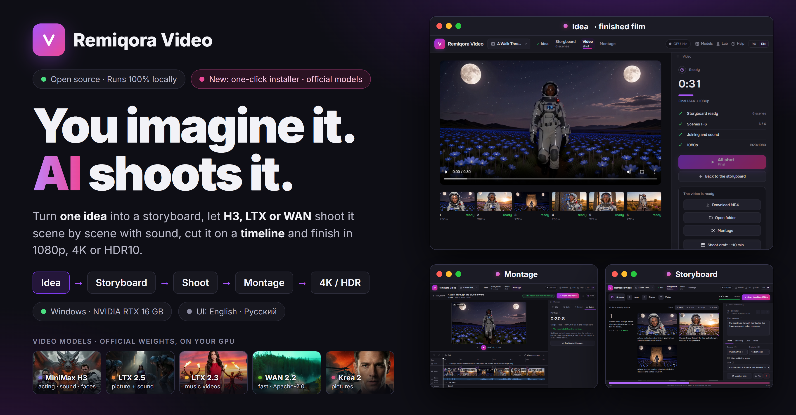
</p>

<p align="center">
  <a href="#why-this-exists">Why</a> ·
  <a href="#whats-inside">What's inside</a> ·
  <a href="#video-models">Models</a> ·
  <a href="#models-to-download">Downloads</a> ·
  <a href="#from-an-idea-to-a-film">Idea → film</a> ·
  <a href="#music-video-from-a-song">Music video</a> ·
  <a href="#montage">Montage</a> ·
  <a href="#graph">Graph</a> ·
  <a href="#lab">Lab</a> ·
  <a href="#built-with">Built with</a> ·
  <a href="#license--liability-for-generated-content">License</a> ·
  <a href="#-installation">Installation</a>
</p>

---

## Why this exists

Modern video models make 5–15 s clips: one scene, one prompt. A film of a minute or more is a lot of manual work around them. You have to write a prompt per scene, keep the hero's face and clothes the same, start each scene from the last frame of the previous one, re-shoot the bad takes, glue it all together with the sound, and upscale the result. Remiqora Video does that work:

- **A writer instead of a blank page.** A local language model (llama.cpp) splits your idea into scenes in the chosen model's own prompt format. It keeps the hero's description word for word in every scene and writes the camera, the action second by second and the spoken lines. On H3 it can put hard cuts inside a scene. You can edit, reorder, pin or rewrite any scene, and «Update the story from this scene» rewrites only the scenes that your edit now contradicts.
- **Chains, not separate clips.** A continuation starts from the last decoded frame of the previous scene, so the picture flows on without a cut. A new location starts a new chain.
- **One worker for every model.** H3, LTX, WAN, Krea 2 and FLUX.2 Klein all run in one process: ComfyUI's core used as a library, with no ComfyUI server and no browser UI. Switching models unloads the old one, and the writer and the video model take turns on the GPU.
- **Nothing is shot twice.** Every scene is cached under a key of everything that defines it. Changing the music, the montage or the output format takes seconds; only the edited scene and its continuations are re-shot.
- **Checks after every scene.** Black frames, frozen video, a jump inside a scene, a drifting face. A serious problem is re-shot once with another seed, and the better take goes into the film.
- **Everything stays on your machine.** No cloud, no accounts; projects are plain folders.

---

## What's inside

| Screen | What it does |
|---|---|
| **Idea** | A couple of sentences in your own words, optionally a photo (as the first frame or only as the hero's look). You choose the model, the length (15 s – 10 min), the frame (16:9, 9:16, 1:1), the mood and who is in the frame (one hero, several, nobody). Four ways to start, as tiles at the top of the home page: the writer, a music video, your own prompts, or a graph. |
| **Storyboard** | A contact sheet: every episode (a chain of scenes shot as one piece) is a row with its number in the margin, its scenes are cards. «Show» switches between Grid, Frame, Script and Graph. Big tabs on top (Scenes, Heroes, Places, Song, Video) each say what is inside. The scene panel has tabs (Frame, Shooting, Lines, Takes): a scene keeps its own model, length, start and end frame, LoRA. «Scene in detail» opens a scene on the whole page with its takes side by side, and a map strip of the video runs along the bottom. **Heroes** is a casting: Krea 2 draws 4 tries at once and keeps them all, you approve one as the portrait, a try with two people or no face is flagged, quick tweaks (younger, shorter hair, smiling…) redraw on the same seed, and «In the scenes» shows how close the face in each shot scene is to the portrait. **Places**: one picture per location, drawn empty by Krea 2; the scenes' start frames are drawn in it, so the place stays the same from scene to scene. «Fix far faces» sharpens small far faces after the shot (LTX 2.3 and Krea 2). «Branch» copies the video to try another take, model or montage without losing this one. «Translate to Russian» shows every scene in Russian while the model still gets English. |
| **Film** | Shoots the scenes in a chain with a live progress line, then assembles the film with sound. Your own track can play on top, and «shoot to the track» is available on LTX 2.3. The output can stay as shot or go to 1080p / 4K (NVIDIA RTX Video), HDR10 (RTX TrueHDR) or 48 fps (RIFE). |
| **Montage** | A timeline over the shot scenes: trim, split, duplicate, speed 0.5–2×, takes, cuts with a flash / dissolve / dip to black, sound tracks, a beat magnet, an «Over» lane for cutaways, one color for the whole film or your own LUT with its strength, a vignette, film grain. One main button (Build video, then Open video), the panel in tabs: Clip, Color, Sound, Output. Exports to **DaVinci Resolve** (FCPXML with its files). |
| **Graph** | A canvas of nodes: idea, hero, writer, prompt, photo, picture (Krea 2 from a prompt, or FLUX.2 Klein from reference pictures), scene, faces, video → video, frame, scene sound, LoRA, join, montage, track, music, output. Useful for two endings, short and long cuts, branches. 16 templates. |
| **Lab** | One scene by hand: a prompt by fields or as text, a start frame, LoRA, any model. «Shoot on all models to compare» runs them on the same prompt and seed. |
| **Models** | The weights by role, where each file lies, downloads from Hugging Face (one at a time, resumable), LoRA folders, the writer's GGUF models, tool paths. |
| **Help** | Built into the app (a button in the header and a «?» by every field): a full reference in both languages — every screen, every graph node, the prompt format, the models, the settings — and 15 step-by-step scenarios: first launch, a film from an idea, your own hero, a music video, montage and Resolve, the finish, fixing one scene, your own LoRA and more. |

The interface is fully bilingual (English / Russian): it starts in your system language, and the switcher in the header overrides it. The writer reads ideas and writes the scenes' texts in any of 17 languages (Models → Writer); the prompts for the video models are always English.

---

## Video models

| Model | Good for | Sound and voice | Scene up to | Draft / final, 16:9 | 5 s draft scene* |
|---|---|---|---|---|---|
| **MiniMax H3** | faces and acting; faces from photos (Ref2VA, up to 9 photos) | its own sound, spoken lines in the video's language | 15 s | 960×544 / 1344×768 | ≈ 95 s |
| **LTX 2.5** | fast scenes with sound; «arrive at a frame» (first + last frame) | its own sound, lines | 10 s | 1024×576 / 1280×704 | ≈ 29 s |
| **LTX 2.3** | music videos: shoots to your track, heroes sing; the hero's voice from a sample (ID-LoRA) | its own sound, lines | 10 s | 1024×576 / 1280×704 | ≈ 32 s |
| **WAN 2.2 5B** | picture only; Apache-2.0 | none | 5 s | 960×544 / 1280×704 | ≈ 120 s |
| **WAN 2.2 5B · FastWan** | the same, 8 steps instead of 20 | none | 5 s | 960×544 / 1280×704 | ≈ 40 s |
| **Krea 2** (pictures) | the hero's casting, places, the graph's «Picture» node | — | — | frame size | ≈ 3.5 s |
| **FLUX.2 Klein** (pictures by reference) | a scene's start frame from the hero's photo in the scene's place (drawn into the place's picture); «Picture» by reference pictures | — | — | frame size | ≈ 5 s |

\* Measured on an RTX 4080 16 GB with the model already in memory. The Models page shows this machine's own measurements.

Each model has its own LoRA folder: put a `.safetensors` file there and it shows up in the lists. **Video → video** remakes a clip through LoRA that read the clip itself: IC-LoRA for LTX 2.5 and 2.3 (background removal, restore, deblur, 3D render, another camera angle) and H3 Ref2VA. A matte LoRA gives the clip an alpha channel (WebM VP9 or ProRes MOV).

### Your own and compatible models

Only the official weights are installed, but any file of the same build shoots too: another quant, a fine-tune, a repack. Put the `.safetensors` into the folder of its kind (`diffusion_models`, `text_encoders`, `vae`, `checkpoints`, `loras`) and the **Models** page finds it by name and lists it as «your own file» next to the official one; «Use» switches the slot to it, no restart. Only the role is checked, by the file name, not the contents: a file of another build fails in the worker. `.gguf` files (the worker runs without ComfyUI-GGUF) and sharded diffusers folders do not load. An H3 model with the speed-up built in («TURBO» in its name) shoots without the turbo LoRA by itself. The writer takes any chat GGUF; one with an mmproj beside it also sees photos.

---

## Models to download

Only the official weights, from the model authors or their official ComfyUI repacks. Each set is complete on its own: a model is offered only when all its files are in place. Sizes are from Hugging Face (GB = 10⁹ bytes). **Folder** is the subfolder of your weights folder (`H3_MODEL_ROOTS`), and every file can be downloaded on the Models page.

**MiniMax H3** ([Comfy-Org/MiniMax-H3](https://huggingface.co/Comfy-Org/MiniMax-H3), the ComfyUI repack of [MiniMaxAI/MiniMax-H3](https://huggingface.co/MiniMaxAI/MiniMax-H3); the original is in diffusers shards that the worker does not load) — 44.4 GB

| File | Folder | GB |
|---|---|---|
| [`minimax_h3_fl2va_pruned_int8_convrot.safetensors`](https://huggingface.co/Comfy-Org/MiniMax-H3/blob/main/diffusion_models/minimax_h3_fl2va_pruned_int8_convrot.safetensors) | `diffusion_models` | 21.0 |
| [`minimax_h3_fl2v_turbo_8step_v1.0_comfyui_bf16.safetensors`](https://huggingface.co/Comfy-Org/MiniMax-H3/blob/main/loras/minimax_h3_fl2v_turbo_8step_v1.0_comfyui_bf16.safetensors) (8 steps) | `loras` | 2.0 |
| [`qwen3vl_32b_minimax_h3_nvfp4_awq.safetensors`](https://huggingface.co/Comfy-Org/MiniMax-H3/blob/main/text_encoders/qwen3vl_32b_minimax_h3_nvfp4_awq.safetensors) | `text_encoders` | 15.7 |
| [`minimax_h3_video_vae_fp16.safetensors`](https://huggingface.co/Comfy-Org/MiniMax-H3/blob/main/vae/minimax_h3_video_vae_fp16.safetensors) | `vae` | 5.2 |
| [`minimax_h3_audio_vae_fp32.safetensors`](https://huggingface.co/Comfy-Org/MiniMax-H3/blob/main/vae/minimax_h3_audio_vae_fp32.safetensors) | `vae` | 0.6 |

**H3 Ref2VA**, faces from photos (the same repository; the text encoder and VAE are H3's) — 22.9 GB

| File | Folder | GB |
|---|---|---|
| [`minimax_h3_ref2va_pruned_int8_convrot.safetensors`](https://huggingface.co/Comfy-Org/MiniMax-H3/blob/main/diffusion_models/minimax_h3_ref2va_pruned_int8_convrot.safetensors) | `diffusion_models` | 21.0 |
| [`minimax_h3_ref2v_turbo_4step_v0.1_comfyui_bf16.safetensors`](https://huggingface.co/Comfy-Org/MiniMax-H3/blob/main/loras/minimax_h3_ref2v_turbo_4step_v0.1_comfyui_bf16.safetensors) (4 steps) | `loras` | 2.0 |

**The writer** ([ggml-org/gemma-4-E4B-it-GGUF](https://huggingface.co/ggml-org/gemma-4-E4B-it-GGUF), Apache-2.0) — 8.6 GB

| File | Folder | GB |
|---|---|---|
| [`gemma-4-E4B-it-Q8_0.gguf`](https://huggingface.co/ggml-org/gemma-4-E4B-it-GGUF/blob/main/gemma-4-E4B-it-Q8_0.gguf) | `llm` | 8.0 |
| [`mmproj-gemma-4-E4B-it-Q8_0.gguf`](https://huggingface.co/ggml-org/gemma-4-E4B-it-GGUF/blob/main/mmproj-gemma-4-E4B-it-Q8_0.gguf) (so it can see photos) | `llm` | 0.6 |

**Krea 2**, pictures ([Comfy-Org/Krea-2](https://huggingface.co/Comfy-Org/Krea-2)) — 19.0 GB

| File | Folder | GB |
|---|---|---|
| [`krea2_turbo_int8_convrot.safetensors`](https://huggingface.co/Comfy-Org/Krea-2/blob/main/diffusion_models/krea2_turbo_int8_convrot.safetensors) | `diffusion_models` | 13.5 |
| [`qwen3vl_4b_fp8_scaled.safetensors`](https://huggingface.co/Comfy-Org/Krea-2/blob/main/text_encoders/qwen3vl_4b_fp8_scaled.safetensors) | `text_encoders` | 5.2 |
| [`qwen_image_vae.safetensors`](https://huggingface.co/Comfy-Org/Krea-2/blob/main/vae/qwen_image_vae.safetensors) | `vae` | 0.3 |

**FLUX.2 Klein 4B**, pictures by reference ([Comfy-Org/Flux-2-Klein-4B](https://huggingface.co/Comfy-Org/Flux-2-Klein-4B), Apache-2.0; the text encoder comes from [Comfy-Org/z_image_turbo](https://huggingface.co/Comfy-Org/z_image_turbo)) — 13.7 GB

| File | Folder | GB |
|---|---|---|
| [`flux-2-klein-4b.safetensors`](https://huggingface.co/Comfy-Org/Flux-2-Klein-4B/blob/main/split_files/diffusion_models/flux-2-klein-4b.safetensors) | `diffusion_models` | 7.8 |
| [`qwen_3_4b_fp8_mixed.safetensors`](https://huggingface.co/Comfy-Org/z_image_turbo/blob/main/split_files/text_encoders/qwen_3_4b_fp8_mixed.safetensors) (Comfy-Org/z_image_turbo) | `text_encoders` | 5.6 |
| [`flux2-vae.safetensors`](https://huggingface.co/Comfy-Org/Flux-2-Klein-4B/blob/main/split_files/vae/flux2-vae.safetensors) | `vae` | 0.3 |

**LTX 2.5** ([Lightricks/LTX-2.5](https://huggingface.co/Lightricks/LTX-2.5); gated: accept the license on the model page, then add a Hugging Face token on the Models page) — 39.7 GB

| File | Folder | GB |
|---|---|---|
| [`ltx-2.5-22b-distilled-transformer-comfy-int8-convrot.safetensors`](https://huggingface.co/Lightricks/LTX-2.5/blob/main/diffusion_models/ltx-2.5-22b-distilled-transformer-comfy-int8-convrot.safetensors) | `diffusion_models` | 21.5 |
| [`gemma4-12b-with-proj-ltx-2.5-comfy-int8-convrot.safetensors`](https://huggingface.co/Lightricks/LTX-2.5/blob/main/text_encoders/gemma4-12b-with-proj-ltx-2.5-comfy-int8-convrot.safetensors) | `text_encoders` | 15.4 |
| [`ltx-2.5-video-vae-bf16.safetensors`](https://huggingface.co/Lightricks/LTX-2.5/blob/main/vae/ltx-2.5-video-vae-bf16.safetensors) | `vae` | 1.5 |
| [`ltx-2.5-audio-vae-bf16.safetensors`](https://huggingface.co/Lightricks/LTX-2.5/blob/main/vae/ltx-2.5-audio-vae-bf16.safetensors) | `vae` | 0.4 |
| [`ltx-2.5-latent-spatial-upscaler-x2-bf16-1.0.safetensors`](https://huggingface.co/Lightricks/LTX-2.5/blob/main/latent_upscale_models/ltx-2.5-latent-spatial-upscaler-x2-bf16-1.0.safetensors) | `latent_upscale_models` | 1.0 |

**LTX 2.3**, music videos — 42.3 GB

| File | Folder | GB |
|---|---|---|
| [`ltx-2.3-22b-dev-fp8.safetensors`](https://huggingface.co/Lightricks/LTX-2.3-fp8/blob/main/ltx-2.3-22b-dev-fp8.safetensors) (Lightricks/LTX-2.3-fp8) | `checkpoints` | 29.1 |
| [`gemma_3_12B_it_fp4_mixed.safetensors`](https://huggingface.co/Comfy-Org/ltx-2/blob/main/split_files/text_encoders/gemma_3_12B_it_fp4_mixed.safetensors) (Comfy-Org/ltx-2) | `text_encoders` | 9.4 |
| [`ltx_2.3_22b_distilled_1.1_lora_dynamic_fro09_avg_rank_111_bf16.safetensors`](https://huggingface.co/Comfy-Org/ltx-2.3/blob/main/split_files/loras/ltx_2.3_22b_distilled_1.1_lora_dynamic_fro09_avg_rank_111_bf16.safetensors) (Comfy-Org/ltx-2.3) | `loras` | 2.7 |
| [`ltx-2.3-spatial-upscaler-x2-1.1.safetensors`](https://huggingface.co/Lightricks/LTX-2.3/blob/main/ltx-2.3-spatial-upscaler-x2-1.1.safetensors) (Lightricks/LTX-2.3) | `latent_upscale_models` | 1.0 |

**WAN 2.2 5B** and **FastWan** (Apache-2.0) — 18.8 GB

| File | Folder | GB |
|---|---|---|
| [`wan2.2_ti2v_5B_fp16.safetensors`](https://huggingface.co/Comfy-Org/Wan_2.2_ComfyUI_Repackaged/blob/main/split_files/diffusion_models/wan2.2_ti2v_5B_fp16.safetensors) | `diffusion_models` | 10.0 |
| [`umt5_xxl_fp8_e4m3fn_scaled.safetensors`](https://huggingface.co/Comfy-Org/Wan_2.1_ComfyUI_repackaged/blob/main/split_files/text_encoders/umt5_xxl_fp8_e4m3fn_scaled.safetensors) | `text_encoders` | 6.7 |
| [`wan2.2_vae.safetensors`](https://huggingface.co/Comfy-Org/Wan_2.2_ComfyUI_Repackaged/blob/main/split_files/vae/wan2.2_vae.safetensors) | `vae` | 1.4 |
| [`Wan2_2_5B_FastWanFullAttn_lora_rank_128_bf16.safetensors`](https://huggingface.co/Kijai/WanVideo_comfy/blob/main/FastWan/Wan2_2_5B_FastWanFullAttn_lora_rank_128_bf16.safetensors) (for «WAN · FastWan») | `loras` | 0.7 |

**Music and clip checks** — about 3 GB; the `.exe` installer fetches them, the scripts leave them to the first use

| What | Source | Size |
|---|---|---|
| Whisper large-v3 (a song's words) | [Systran/faster-whisper-large-v3](https://huggingface.co/Systran/faster-whisper-large-v3) | 3.1 GB |
| Demucs `htdemucs` (voice from music) | [adefossez/HTDemucs](https://huggingface.co/adefossez/HTDemucs), by Demucs itself | ~0.3 GB |
| WeSpeaker ResNet34 (is the voice the same) | [Wespeaker/wespeaker-voxceleb-resnet34-LM](https://huggingface.co/Wespeaker/wespeaker-voxceleb-resnet34-LM) | 25 MB |
| YuNet, SFace (faces and lips) | [opencv/opencv_zoo](https://github.com/opencv/opencv_zoo) | ~40 MB |

The minimum to shoot is **H3 and the writer**, about 53 GB. Everything above is about 210 GB. Style LoRA are never downloaded by the app: put your own into the model's LoRA folder.

---

## From an idea to a film

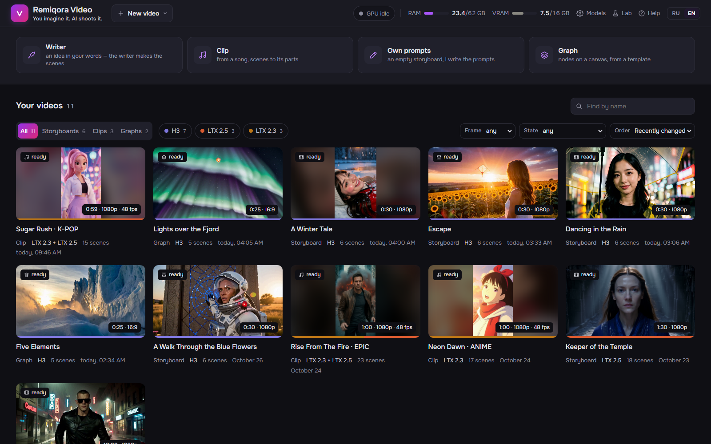

1. **Idea.** «A girl in a red coat walks along the night embankment in the rain, stops at a lamp and smiles into the camera.» The more concrete the place, light, clothes and ending, the more coherent the scenes. A 30 s film is 6 scenes of 5 s, or 3 scenes of 10 s on LTX.
2. **Storyboard.** It takes the writer 20–30 s. The scenes are laid out as a contact sheet, one row per episode. Every edit is saved at once. You can rewrite a scene, ask for another variant, pin the ones you like, add a scene, or switch to your own prompts. Under «Heroes», Krea 2 draws four tries of the hero and you approve one as the portrait; under «Places», each location gets one picture, so the place stays the same across scenes.
3. **Film.** «Shoot film». A 30 s draft takes about 10 minutes on H3 and 3.5–4 on LTX. You can stop after the current scene and continue later: the shot scenes stay in the cache. «Shoot final» re-shoots the same scenes with the same seeds at the final size.
4. **Montage** (optional). Trim, reorder, transitions, a track, one color, then «Build video». Nothing is re-shot.
5. **Finish.** As shot, 1080p, 4K, HDR10 or 48 fps. Changing the output only re-processes; it never re-shoots.

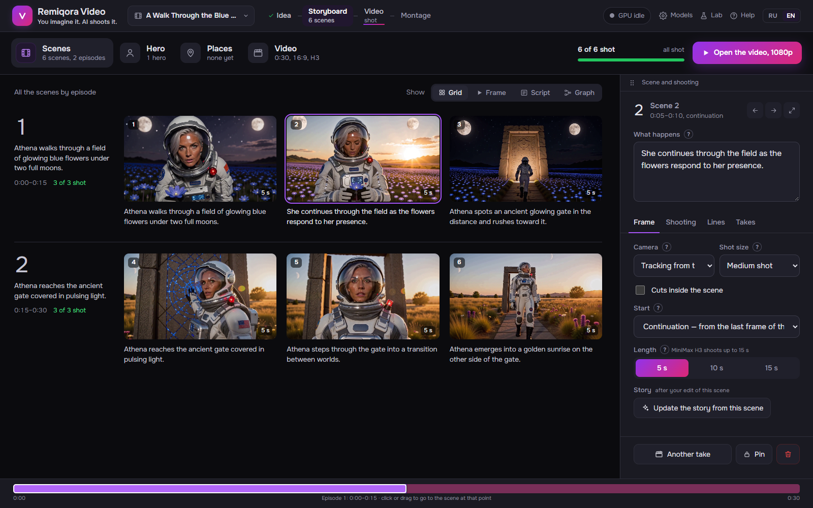

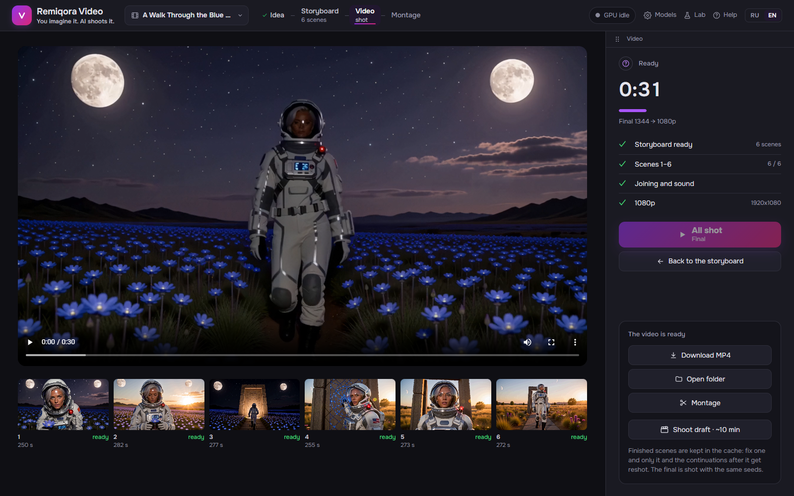

---

## Music video from a song

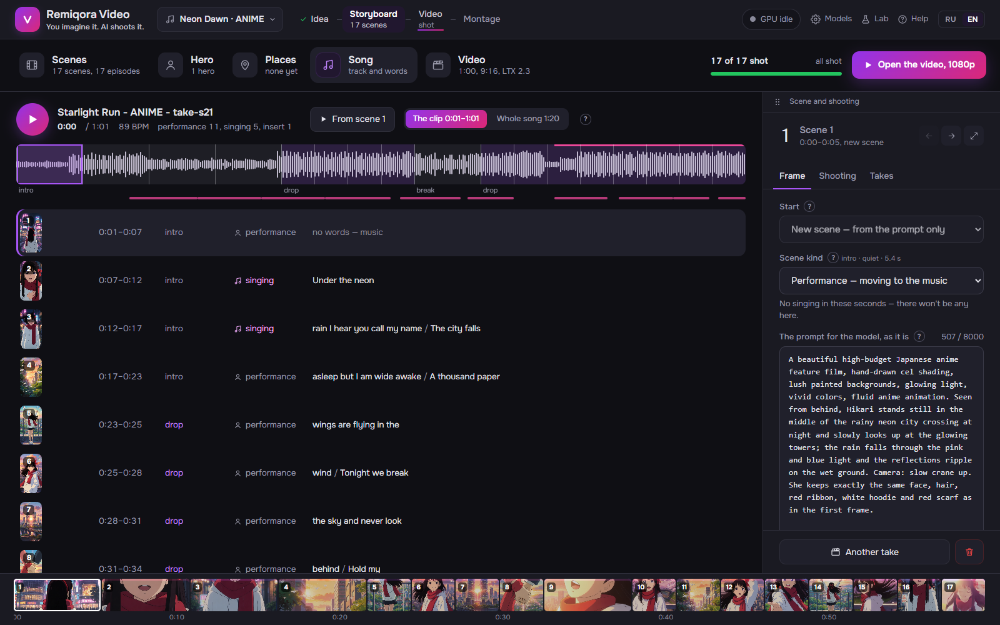

The «Clip» switch on the main screen. The song is analyzed in about a second: tempo, bars, quiet and loud parts, the chorus. The words are recognized with their timing: the voice is separated by Demucs, the words come from Whisper large-v3, about 40 s on the GPU. Scenes are cut to whole bars, about 3 s in loud parts and twice that in quiet ones. There are three kinds: **singing** (the face in close-up, only where the voice is), **performance** and **insert** (a detail without a face). The writer first writes a treatment (format, palette, a motif that grows towards the chorus), then the scenes.

LTX 2.3 hears its piece of the track and moves the lips to the voice, so it shoots music videos by default. Without a singer's photo, Krea 2 draws the singer from the writer's description, and the singing scenes start from that face. FLUX.2 Klein draws each new scene's start frame with that face, in the scene's place.

---

## Montage

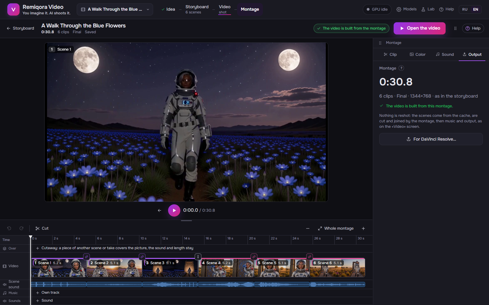

- One main button: «Build video», then «Open video». The panel is in tabs: Clip, Color, Sound, Output.
- Drag the clip edges to trim. **S** splits at the playhead, **Ctrl+D** duplicates, speed is set per clip (0.5–2×, the sound keeps its pitch).
- A chain moves as one block, and the icon above each cut says whether it is seamless, a jump or a new scene.
- Transitions: cut, white flash (4 frames, the default into a loud part of a music video), dissolve, through black.
- Takes: if a scene has several, a clip can use any of them without changing the storyboard.
- **Over**, a lane for cutaways: a piece of another scene or take covers the picture on its stretch, while the sound and the length stay as they were.
- Sound: the scene's own sound with its volume per clip, your music track (volume, start, fades, «scene sound under it»), a «Sounds» lane for your files. The **beat magnet** snaps trims and sounds to the track's beats, and «Cuts on beats» moves every cut onto a beat. If the found beats are off, play the video and press **B** on the real beats: the found beats move and stretch onto your taps.
- Color: «As shot», «Film», «Warm», «Cold», «Teal and orange», «Black and white» or your own `.cube` LUT, with its strength, a vignette and film grain; «Before / after» shows the picture with and without the color. «Match scenes' color» evens out color and contrast across the film.
- **Ctrl+Z / Ctrl+Y** for any edit. The player plays the montage in the browser with the transitions and the sound.
- **For DaVinci Resolve:** an FCPXML timeline with the files it plays, in a folder you choose. Scenes not shot yet become named gaps of their length.

---

## Graph

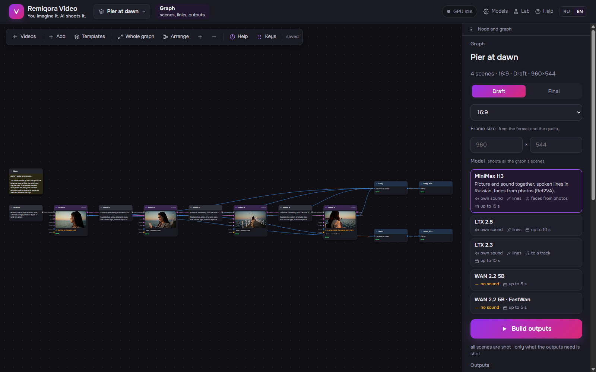

A storyboard is one chain of scenes. The graph is a canvas where scenes, pictures, sound and outputs connect any way you like: two videos from shared scenes, a scene that starts from a frame in the middle of another, a voice from one scene given to the hero in another, one LoRA style over a whole chain. Each node does one thing, ports of the same type connect, and only what the outputs need gets shot. A graph has its own model (H3, LTX or WAN), and a scene can have its own.

**What a graph is made of**

| Node | What it does |
|---|---|
| **Idea**, **Hero**, **Writer** | The idea and the heroes' looks go to the Writer: it writes the scenes, and «Expand into scenes» builds prompts, scenes, a join and an output from them |
| **Prompt** | The text for the model, whole or by fields as in the Lab; «Lines» is who says what |
| **Photo**, **Picture** | Your own picture, or a frame drawn by Krea 2 from a prompt or by FLUX.2 Klein from reference pictures (each with its own LoRA folder): a scene's first frame or a face for Ref2VA |
| **Scene** | Shoots the prompt with the chosen model; starts from a frame, ends at a frame (LTX), takes with different seeds |
| **Frame**, **Scene sound** | A frame from any moment of a shot scene; its sound, so the hero speaks with the same voice elsewhere |
| **Faces** | Sharpens small far faces in a shot scene and keeps them the same from frame to frame (LTX 2.3 and Krea 2) |
| **Video → video** | Reshoots a clip through LoRA that read the clip itself: another angle, a 3D render, no background |
| **LoRA** | One LoRA set over several scenes; any scene can be disconnected |
| **Join**, **Montage** | Scenes in order, or a timeline with trims and transitions |
| **Track**, **Music** | Your file over the video: volume, start, «scene sound under it» |
| **Output** | The finished video: size, 1080p / 4K / HDR, 48 fps; a graph may have several |
| **Note**, **Group** | To keep a big canvas readable |

**Templates**

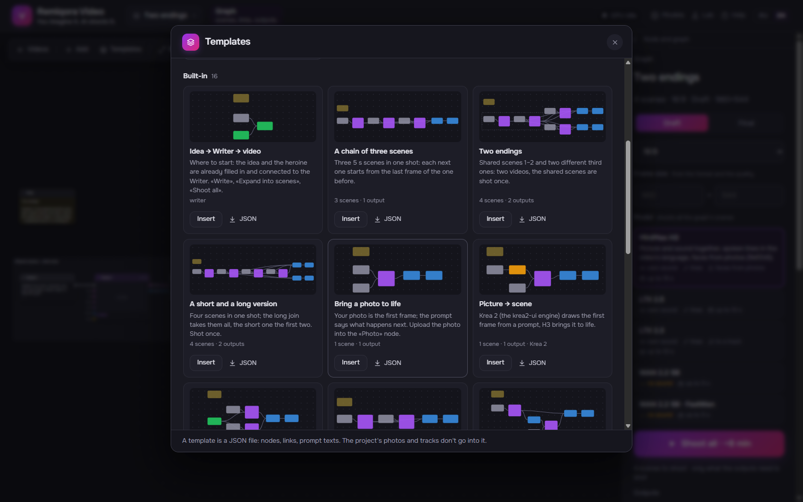

«Templates» on the canvas holds 16 ready graphs; any graph of yours is saved as a template too and travels as a JSON file.

| Template | What for |
|---|---|
| Idea → Writer → video | Where to start: the idea and the heroine are filled in and connected to the Writer |
| Writer · Writer and a face from a photo | The same without the sample; the second shoots the expanded scenes with Ref2VA and the hero's photo |
| A chain of three scenes | Three scenes in one shot, each starting from the last frame of the one before |
| Two endings | Shared scenes 1–2 and two different third ones: two videos, the shared scenes shot once |
| A short and a long version | Four scenes; the long join takes them all, the short one the first two |
| Bring a photo to life | Your photo is the first frame, the prompt says what happens next |
| Picture → scene | Krea 2 draws the first frame from a prompt, the video model brings it to life |
| One face in different places | A photo of a person into the «faces» input of two scenes: Ref2VA keeps the face |
| A dialogue of two | Two scenes in one shot: she speaks, he answers |
| Another angle from the middle | A «Frame» at 2.5 s of the first scene starts the second: the same moment, another shot |
| Three takes and the best one | One scene with three seeds: shoot them all, the best goes into the join |
| Your own style with a LoRA | One LoRA set over every scene of the chain |
| A clip to your own track | Three scenes with changes of shot, your track instead of the scene sound, 1080p and 48 fps |
| Trailer: five places | Five new shots without people, a track on top, 4K output |
| A landscape in one chain | Three scenes without people in one pan, 48 fps |

**Three examples**

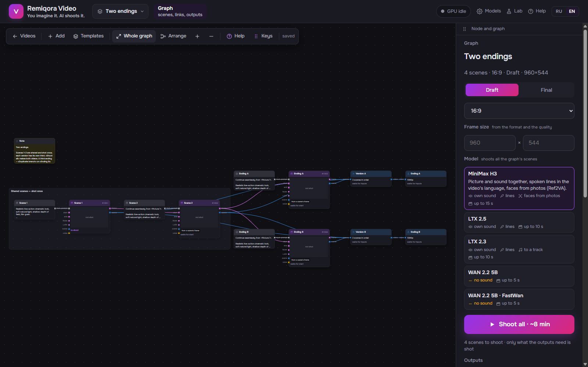

*Two endings.* Scenes 1 and 2 are shared; two different third scenes branch off the second, each with its own join and output. The shared scenes are shot once, and rewriting either ending reshoots only that ending.

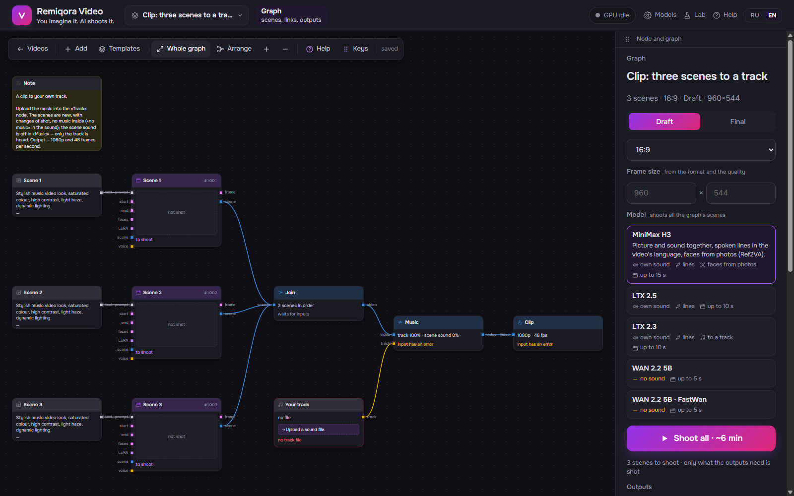

*A clip to your own track.* Three scenes with their prompts go into a join; «Track» is your file, «Music» lays it over and mutes the scene sound; «Output» gives 1080p at 48 fps. Swap the prompts and the track and it is your clip.

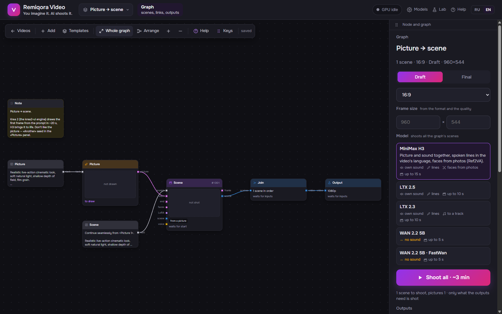

*Picture → scene.* «Picture» draws the first frame from its own prompt in a few seconds, so you can reroll until you like it; «Scene» starts from it and animates it by a second prompt. The frame and the motion are chosen separately.

---

## Lab

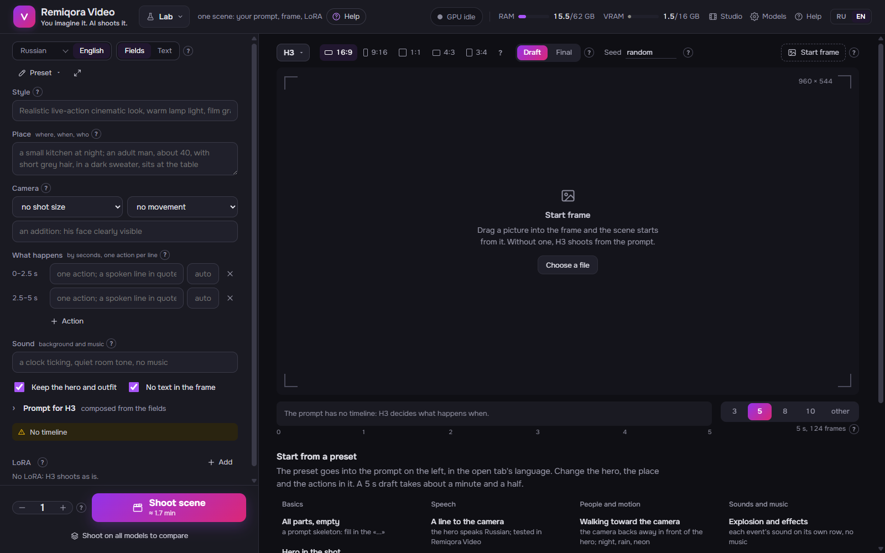

One scene by hand, outside any film: a prompt by fields (style, place, who, action, camera, sound, lines) or as one text, a start frame, LoRA and any model. The writer turns a description in your language into the chosen model's English prompt, and «Shoot on all models to compare» compares H3, LTX and WAN on the same prompt and seed. Presets cover the usual cases: bring a photo to life, a line to the camera, a dialogue, a dance for a music video, nature, a 3D cartoon, old film and more.

## Models page

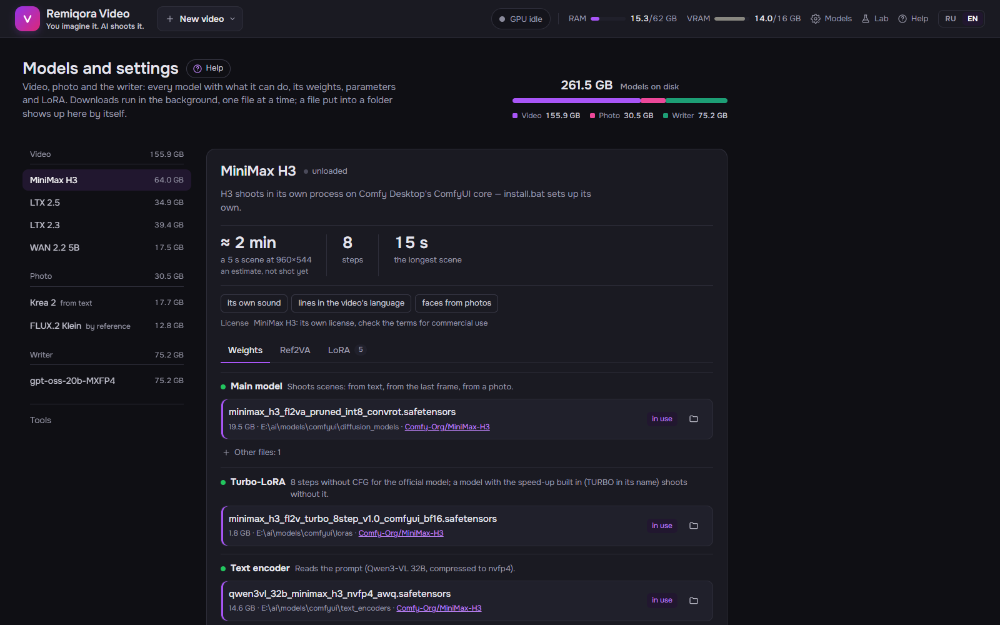

Every model's files by role, where each one lies or would go, its size and its source on Hugging Face. Downloads run in the background one at a time and resume after a stop; a file put into a folder by hand shows up by itself. Here too: the writer's GGUF models, LoRA folders, tool paths, the measured speed of each model on this machine and, in the desktop app, «Add model sets».

---

## Built with

Remiqora Video is the UI, the writer's prompts, the storyboard, the render pipeline and the montage on top of third-party engines and models. None of them is vendored into this repository:

| Project | What's used | License |
|---|---|---|
| [ComfyUI](https://github.com/comfyanonymous/ComfyUI) (core only) | The engine for every video model, Krea 2 and FLUX.2 Klein, imported as a library by our own worker at a pinned commit (`engine/core.txt`); no ComfyUI server, frontend or custom nodes | GPL-3.0 |
| [MiniMax H3](https://huggingface.co/MiniMaxAI/MiniMax-H3) (ComfyUI repack: [Comfy-Org/MiniMax-H3](https://huggingface.co/Comfy-Org/MiniMax-H3)) | Video with sound, Ref2VA | MiniMax H3 Community License |
| [LTX 2.5](https://huggingface.co/Lightricks/LTX-2.5) / [LTX 2.3](https://huggingface.co/Lightricks/LTX-2.3) | Video with sound, music videos, ID-LoRA, IC-LoRA | LTX-2 Community License |
| [WAN 2.2 5B](https://huggingface.co/Comfy-Org/Wan_2.2_ComfyUI_Repackaged), [FastWan](https://huggingface.co/Kijai/WanVideo_comfy) | Video without sound | Apache-2.0 |
| [Krea 2](https://huggingface.co/Comfy-Org/Krea-2) | Pictures | Krea 2 Community License |
| [FLUX.2 Klein 4B](https://huggingface.co/Comfy-Org/Flux-2-Klein-4B) | Pictures by reference: scene start frames, places | Apache-2.0 |
| [llama.cpp](https://github.com/ggml-org/llama.cpp) (or [LM Studio](https://lmstudio.ai)'s signed engine) | The writer's local server | MIT |
| [Gemma 4 E4B](https://huggingface.co/ggml-org/gemma-4-E4B-it-GGUF) | The default writer (any GGUF works) | Apache-2.0 |
| [Demucs](https://github.com/adefossez/demucs), [faster-whisper](https://github.com/SYSTRAN/faster-whisper) | A song's voice and words, a scene's voice | MIT |
| [OpenCV](https://opencv.org) YuNet / SFace, [WeSpeaker](https://github.com/wenet-e2e/wespeaker) | Clip checks: faces, lips, voice similarity | Apache-2.0 / CC-BY-4.0 (model) |
| [RIFE](https://github.com/nihui/rife-ncnn-vulkan) (ncnn-vulkan) | 48 fps | MIT |
| [NVIDIA RTX Video SDK](https://developer.nvidia.com/rtx-video-sdk) | 1080p / 4K (VSR) and HDR10 (TrueHDR), through our small pipe tool `rtx_vsr` | NVIDIA proprietary license |
| [FFmpeg](https://ffmpeg.org) | Assembly, sound, encoding | LGPL / GPL |
| [FastAPI](https://fastapi.tiangolo.com), [Vue 3](https://vuejs.org), [Vue Flow](https://vueflow.dev), [PyTorch](https://pytorch.org) | Server, page, graph canvas, engine runtime | MIT / BSD |

---

## License & liability for generated content

Remiqora Video's own code (this repository) is licensed under [GPL-3.0](LICENSE), the same as the ComfyUI core it runs. The license covers the app only. It does not cover a *video* you make with it: the videos come from third-party models, so:

- **The author of Remiqora Video takes no responsibility** for what you make with it or how you use it afterwards, commercially or not, published or private.
- **Local laws are your responsibility.** Some models, MiniMax H3 among them, may be banned or restricted in some countries. The installer and the Models page download the weights straight from the rights holders' pages on Hugging Face; Remiqora Video does not host or distribute them. Before installing or using a model, make sure it is legal where you live. The author takes no responsibility for installing or using any model where it is prohibited.
- **Real people need their consent.** Don't make or share videos of a real person (a face from a photo, a voice from a sample) without their permission, and don't make anything illegal.
- **A generated video falls under the license of the model that made it.** The licenses differ:
  - **MiniMax H3**: the MiniMax H3 Community License. Read its terms before any commercial use.
  - **LTX 2.5 / 2.3**: the LTX-2 Community License, free for companies with under US $10M annual revenue.
  - **WAN 2.2 5B**: Apache-2.0, commercial use allowed.
  - **Krea 2**: the Krea 2 Community License.
  - **FLUX.2 Klein 4B**: Apache-2.0, commercial use allowed.
  - **The writer** writes only text; check the license of the GGUF model you use.
- Before publishing or monetizing a video, **check the current terms on the model's page**: they belong to the model's rights holder and can change independently of this repository.
- The NVIDIA RTX Video SDK files are NVIDIA's property under NVIDIA's license, not this repository's. They are never committed here.
- Remiqora Video is provided "as is", without warranty of any kind.
- **Attribution:** if you fork or build on this code, keep the credit: a link to this repository and to Nikolay Cherkashin ([inikolax](https://github.com/inikolax)) as the original author. GPL-3.0 also requires keeping the copyright and license notices and publishing the source of your version if you distribute it.

---

## 📦 Installation

Requirements: **Windows 11**, an **NVIDIA RTX GPU with 16 GB** of video memory (tested on an RTX 4080 16 GB, 62 GB RAM, driver 617), and room for the weights. The minimum set (H3 and the writer) is about 53 GB, everything about 210 GB ([Models to download](#models-to-download)).

There are two ways to install, as in Remiqora: the `.exe` installer or the scripts from source. Both download **only the official weights** of the model authors (or Comfy-Org's official ComfyUI repacks) from one list, [`install/manifest.json`](install/manifest.json). Your own files (other quants, fine-tunes) go into the models folder and are picked on the **Models** page.

Model sets:

| Set | What it gives | Size |
|---|---|---|
| H3 | The main video model (official, with its 8-step turbo LoRA) | 44 GB |
| Writer | Gemma 4 E4B and llama.cpp: prompts, lines, storyboards | 9 GB |
| Krea 2 | Pictures: the heroes' casting, places, «Picture» from a prompt | 19 GB |
| FLUX.2 Klein | Scene start frames from the hero's and the place's pictures; «Picture» by reference | 14 GB |
| Ref2VA | Heroes' faces from a photo (with H3) | 23 GB |
| LTX 2.5 | The second video model; needs a Hugging Face token and its license accepted | 40 GB |
| LTX 2.3 | Music videos to a finished track | 42 GB |
| WAN 2.2 5B | A fast model without sound | 19 GB |

Profiles: **Minimum** (H3 and the writer, ~53 GB), **Pictures and faces** (+ Krea 2, FLUX.2 Klein and Ref2VA, ~109 GB), **Everything** (~210 GB). The installer always adds the engine (~6 GB), Whisper and Demucs for song words, the clip checks' models, RIFE and RTX Video; the scripts install the engine and leave the rest to the first use.

### Way 1: the installer

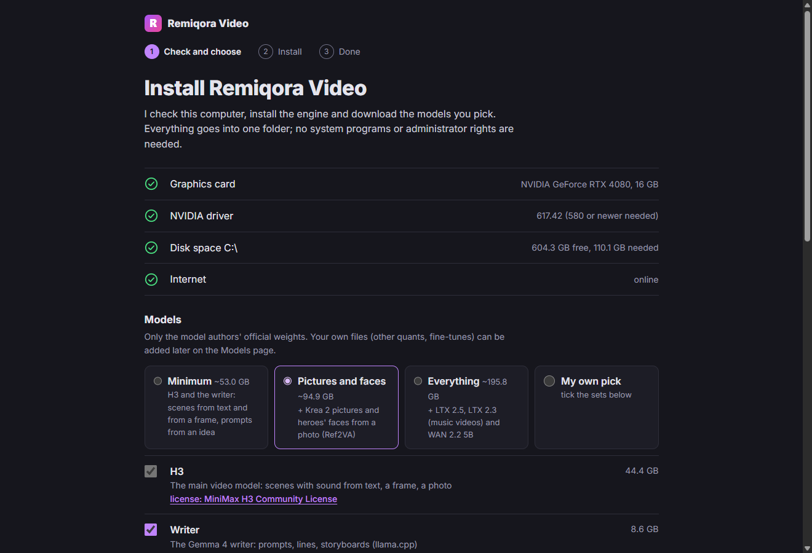

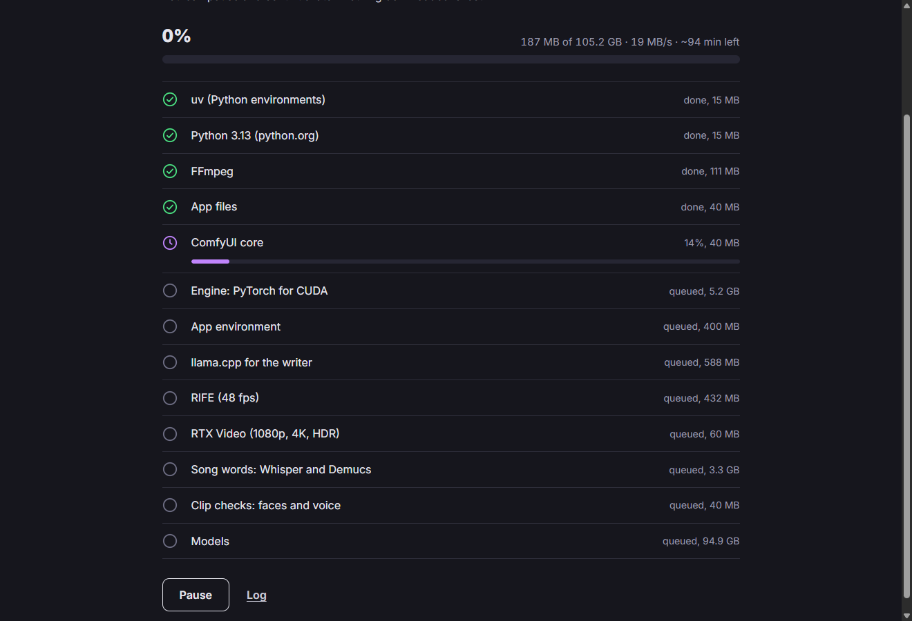

**Download:** [Remiqora-Video-Setup-0.2.1.exe](https://github.com/inikolax/remiqora-video/releases/download/v0.2.1/Remiqora-Video-Setup-0.2.1.exe) (v0.2.1, pre-release; SHA-256 sums on the [Releases](https://github.com/inikolax/remiqora-video/releases) page).

`Remiqora-Video-Setup-<version>.exe` installs per user, without administrator rights. On the first start the wizard:

1. checks the graphics card, the driver (580 or newer), disk space and the connection;
2. offers a profile or sets one by one, links to their licenses, and the folders: the app's (`%LOCALAPPDATA%\RemiqoraVideo` by default) and the models'. «Add a folder» connects weights already downloaded for ComfyUI, Comfy Desktop or Remiqora: files matching by name and size are not downloaded and stay where they are;
3. downloads uv, Python 3.13 from python.org (signed), FFmpeg, the ComfyUI core, the environments from their lock files, llama.cpp, RIFE and the picked sets itself, with pause, resume and sha256 checks. A set that fails does not stop the others: «Try again» continues where it stopped;
4. opens the app in its own window. Later starts go straight into the app; missing sets are added with «Add model sets» on the **Models** page.

To build the installer: `cd frontend && npm ci`, then `cd desktop && npm ci && npm run dist` → `desktop\dist\Remiqora-Video-Setup-<version>.exe`. RTX Video goes inside when `tools\rtxvsr\build.ps1 -SdkDir <NVIDIA RTX Video SDK folder>` has been run first (VS 2022 Build Tools and the CUDA Toolkit needed). The installer is not signed: Windows shows a SmartScreen warning.

### Way 2: from source

```cmd
install.bat
```

On a new machine it first runs `setup_prereqs.bat`, which checks for Git, uv, Python 3.13, Node.js and FFmpeg and installs the missing ones with winget. Then close the window, open a new one and run `install.bat` again. Install the NVIDIA driver yourself from [nvidia.com/drivers](https://www.nvidia.com/drivers).

`setup_models.bat` then asks for the models folder (a path, `B` for a folder picker, Enter for the default). An existing ComfyUI or Comfy Desktop folder works: the files stay in place and the path goes into `.env`. The script pins the ComfyUI core, creates the environments from the lock files, checks PyTorch/CUDA and finally offers a model profile. Switches:

- `-Profile minimum|faces|all` or `-Sets h3,writer,krea,flux2,ref2va,ltx25,ltx23,wan` — no questions asked;
- `-Find "D:\ComfyUI\models"` — more folders with downloaded weights;
- `-SkipWeights` — no models; `-DryRun -ModelsDir <folder>` — only check the folder choice.

Running it again skips what is done and resumes what is not. For LTX 2.5 put a Hugging Face token into `data\hf_token` (or set `HF_TOKEN`) and accept the license on the model's page. The scripts do not install llama.cpp for the writer: put a build into `tools\llama` or install LM Studio.

### Running from source

```cmd
dev.bat
```

Builds the page (served at [http://127.0.0.1:8810](http://127.0.0.1:8810) too), starts the API on port 8810 and the Vite development page at [http://127.0.0.1:5173](http://127.0.0.1:5173). Frontend edits hot-reload in the browser; Python edits restart the API automatically. An active shoot is interrupted when the API restarts. The video worker starts by itself on the first shot (log: `data\h3worker.log`). Close the «Remiqora API» and «Remiqora UI» windows to stop the development servers.

### Models after the install

Open **Models** (the gear in the header). For every model it shows the files it needs, where they lie or would go, and a link to Hugging Face. **Download** fetches them in the background, one at a time, and resumes a stopped download. You can also put files into the folders by hand, and they show up by themselves. A Hugging Face token is needed only for gated repositories (LTX 2.5: accept its license on the model page first).

**The writer** needs `llama-server` and any GGUF model. The server is looked for in `LLAMA_SERVER_BIN`, then in `tools\llama`, then in an installed **LM Studio** (its signed CUDA engine). GGUF files are looked for in LM Studio's download folder and in `LLM_DIRS`. The default writer is Gemma 4 E4B.

**LoRA** are never downloaded: put `.safetensors` into the model's LoRA folder (they are listed on the Models page).

### Smart App Control

On a clean Windows 11 install, Smart App Control may switch itself on after a few days of evaluation. Then it blocks unsigned files that Microsoft's cloud does not know. Right now it hits torch's DLLs, llama.cpp releases and Python builds from uv or conda for many people ([ComfyUI #15117](https://github.com/Comfy-Org/ComfyUI/issues/15117), [PyTorch #199711](https://github.com/pytorch/pytorch/issues/199711), [llama.cpp #30258](https://github.com/ggml-org/llama.cpp/issues/30258)). Remiqora Video uses signed builds where they exist (python.org Python, LM Studio's engine) and explains what to do when the writer's server is blocked. If something is still blocked (Code Integrity events 3033 / 3077 in the Event Viewer, WinError 4551 or 0xC0E90002):

- wait and try again: a file sometimes gains reputation within an hour or a day;
- or turn Smart App Control off: Windows Security → App & browser control → Smart App Control. Since the April 2026 update it can be turned back on without reinstalling Windows.

---

## ⚙ Configuration (.env)

The installer writes the selected model directory into `.env`. Paths and folders can also be changed on the **Models** page: they are saved to `data\settings.json` and apply without a restart. To configure manually, set at least the weights folder:

```ini
H3_MODEL_ROOTS=D:\models\comfyui          # the weights of every model; ; separates several
LORA_DIRS=D:\models\loras\h3
LTX23_LORA_DIRS=D:\models\loras\ltx23
LTX25_LORA_DIRS=D:\models\loras\ltx25
LLM_DIRS=D:\models\llm
RTX_VSR=D:\tools\rtxvsr\rtx_vsr.exe
RIFE_BIN=D:\tools\rife\rife-ncnn-vulkan.exe
```

- `H3_MODEL_ROOTS`: folders with `diffusion_models`, `text_encoders`, `vae`, `loras`, `checkpoints`, `latent_upscale_models`. Every model's weights are looked up there.
- `H3_UNET`, `LTX25_UNET`, `KREA_UNET` and the like: file names by role, also chosen on the Models page.
- `COMFY_DIR`, `COMFY_PYTHON`: the engine. By default it is our own `engine\` from `install.bat`; Comfy Desktop's is the fallback.
- `LLAMA_SERVER_BIN`, `LLM_DIRS`, `LLM_MODEL`, `LLM_CTX`: the writer.
- `FFMPEG`, `FFPROBE`, `RIFE_BIN`, `RTX_VSR`: the tools. ffmpeg on PATH is enough.
- `HOST`, `PORT`: `127.0.0.1:8810` by default. The app has no authentication, so do not expose it outside a trusted network.

The full list with comments is in [`.env.example`](.env.example) and in the app's help («Settings in .env»).

---

## Known limitations

- Windows and NVIDIA only. 16 GB of video memory is the target: LTX peaks at 15.7 GB and keeps the rest in Windows' shared memory.
- The writer and a video model do not fit in video memory together, so they take turns. After the writer, the video model loads again, which takes up to half a minute.
- Every scene composes its own music. For one melody across the film, put your own track on top and switch on «No music in the scenes, only sounds».
- Only H3 keeps faces from photos (Ref2VA). LTX and WAN keep a face through the description and the start frame.
- With people in the frame, chains are kept short (the face drifts over long continuations).
- 1080p / 4K through RTX Video and HDR10 need `rtx_vsr` with NVIDIA's RTX Video SDK files. They are not in git: the installer carries them, from source `tools\rtxvsr\build.ps1` builds them.
- Without NVIDIA RTX Video (another GPU, or a build without its files) 1080p / 4K are scaled by ffmpeg (lanczos) instead, and there is no HDR10.
- The installer is not signed yet: Windows shows a SmartScreen warning, and Smart App Control may block unsigned files (see above).
