<p align="right"><a href="README.md">English</a> · <b>Русский</b></p>

<p align="center">
  
</p>

<h1 align="center">Remiqora Video</h1>
<p align="center"><i>Ты придумал — AI снял.</i></p>

<p align="center">
  Локальная видеостудия на вашей видеокарте. Вы описываете идею парой фраз, локальная языковая модель пишет раскадровку, а <b>MiniMax H3</b>, <b>LTX 2.5 / 2.3</b> или <b>WAN 2.2 5B</b> снимает её сцена за сценой со звуком и склеивает в ролик. Ещё есть монтаж на таймлайне, граф из узлов для веток и версий, клип по тактам песни и финал в 1080p / 4K / HDR10.
</p>

<p align="center">🚧 В активной разработке — возможны несовместимые изменения, ошибки и шероховатости. Это ещё не стабильный выпуск.</p>

<p align="center">
  
  <a href="LICENSE"></a>
  
  
  
  
  <a href="https://ko-fi.com/inikolax"></a>
</p>

<p align="center">
  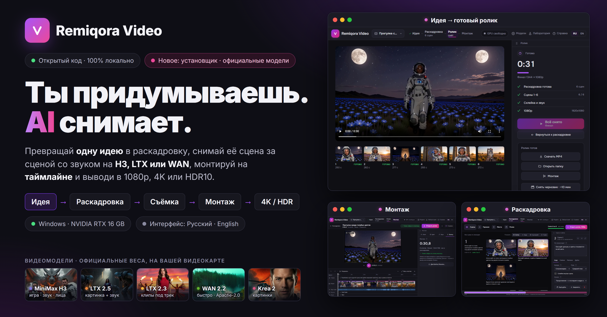
</p>

<p align="center">
  <a href="#зачем-это">Зачем</a> ·
  <a href="#что-внутри">Что внутри</a> ·
  <a href="#модели-видео">Модели</a> ·
  <a href="#что-скачать">Что скачать</a> ·
  <a href="#от-идеи-до-ролика">Идея → ролик</a> ·
  <a href="#клип-из-песни">Клип</a> ·
  <a href="#монтаж">Монтаж</a> ·
  <a href="#граф">Граф</a> ·
  <a href="#лаборатория">Лаборатория</a> ·
  <a href="#на-чём-построено">На чём построено</a> ·
  <a href="#лицензия-и-ответственность-за-созданное">Лицензия</a> ·
  <a href="#-установка">Установка</a>
</p>

---

## Зачем это

Современные видеомодели снимают ролики по 5–15 секунд: одна сцена — один промт. Чтобы получить фильм на минуту и дольше, вокруг них приходится делать много ручной работы. Нужно написать промт к каждой сцене, удержать одно лицо и одну одежду героя, начать каждую сцену с последнего кадра предыдущей, переснять неудачные дубли, склеить всё со звуком и увеличить результат. Remiqora Video делает это за вас:

- **Сценарист вместо пустого листа.** Локальная языковая модель (llama.cpp) делит идею на сцены в формате промта выбранной модели. Описание героя она повторяет в каждой сцене слово в слово, расписывает камеру, действие по секундам и реплики. На H3 она может поставить жёсткие склейки внутри сцены. Любую сцену можно поправить, переставить, закрепить или переписать, а «Обновить сюжет от этой сцены» перепишет только те сцены, которые теперь с вашей правкой не сходятся.
- **Цепочки, а не отдельные клипы.** Продолжение начинается с последнего кадра прошлой сцены, взятого прямо из декодера, и картинка идёт дальше без склейки. Новое место — новая цепочка.
- **Один воркер на все модели.** H3, LTX, WAN, Krea 2 и FLUX.2 Klein работают в одном процессе: ядро ComfyUI подключено как библиотека, без сервера ComfyUI и без его страницы. При смене модели прежняя выгружается, а сценарист и видеомодель занимают видеокарту по очереди.
- **Ничего не снимается дважды.** Каждая сцена хранится в кэше под ключом из всего, что её определяет. Смена музыки, монтажа или формата выхода занимает секунды; переснимаются только поправленная сцена и её продолжения.
- **Проверка после каждой сцены.** Чёрные кадры, замершее видео, скачок внутри сцены, «поплывшее» лицо. Серьёзную проблему приложение один раз переснимает с другим сидом, и в ролик идёт лучший дубль.
- **Всё остаётся на вашем компьютере.** Ни облака, ни аккаунтов; проекты — обычные папки.

---

## Что внутри

| Экран | Что делает |
|---|---|
| **Идея** | Пара фраз своими словами и по желанию фото — как первый кадр или только как внешность героя. Здесь выбираются модель, длина (от 15 с до 10 мин), кадр (16:9, 9:16, 1:1), настроение и кто в кадре (один герой, несколько, без людей). Начать можно четырьмя способами, они плитками сверху на главной: сценарист, клип, свои промты, граф. |
| **Раскадровка** | Монтажный лист: каждый эпизод (цепочка сцен, снятых одним куском) — строка с его номером на полях, сцены в ней — карточки. «Показать» переключает вид: Сетка, Кадр, Сценарий, Граф. Большие вкладки сверху (Сцены, Герои, Места, Песня, Ролик) говорят, что в каждой. Панель сцены — во вкладках (Кадр, Съёмка, Реплики, Дубли): у сцены своя модель, длина, первый и последний кадр, LoRA. «Сцена подробно» открывает сцену на всю страницу, с дублями рядом, а внизу идёт полоса-карта ролика. **Герои** — это кастинг: Krea 2 рисует сразу 4 пробы и хранит все, вы утверждаете одну портретом, проба с двумя людьми или без лица помечается, быстрые правки (моложе, волосы короче, улыбается…) перерисовывают на том же сиде, а «В сценах» показывает, насколько лицо в каждой снятой сцене похоже на портрет. **Места**: у каждого места одна картинка — Krea 2 рисует его пустым, а кадры сцен рисуются уже в нём, и место остаётся тем же от сцены к сцене. «Починить далёкие лица» делает мелкие далёкие лица резче после съёмки (LTX 2.3 и Krea 2). «Ветка» — копия ролика, чтобы попробовать другой дубль, модель или монтаж, не теряя этот. «Перевести на русский» показывает все сцены по-русски; модель по-прежнему получает английский. |
| **Ролик** | Снимает сцены цепочкой со строкой прогресса и склеивает ролик со звуком. Поверх можно положить свой трек, а на LTX 2.3 — снимать прямо под него. На выходе — как снято, 1080p / 4K (NVIDIA RTX Video), HDR10 (RTX TrueHDR) или 48 кадров в секунду (RIFE). |
| **Монтаж** | Таймлайн из снятых сцен: обрезка, разрез, копия, скорость 0,5–2×, дубли, переходы (вспышка, наплыв, через чёрное), звуковые дорожки, магнит по долям, дорожка «Поверх» для перебивок, единый цвет ролика или свой LUT с его силой, виньетка, зерно плёнки. Одна главная кнопка («Собрать ролик», потом «Открыть ролик»), панель во вкладках: Клип, Цвет, Звук, Выход. Выгрузка в **DaVinci Resolve** — таймлайн FCPXML с файлами. |
| **Граф** | Холст из узлов: идея, герой, сценарист, промт, фото, картинка (Krea 2 по промту или FLUX.2 Klein по картинкам-образцам), сцена, лица, видео → видео, кадр, звук сцены, LoRA, склейка, монтаж, трек, музыка, выход. Подходит для двух концовок, короткой и длинной версии, веток. 16 шаблонов. |
| **Лаборатория** | Одна сцена вручную: промт по полям или текстом, стартовый кадр, LoRA, любая модель. «Снять на всех моделях» сравнивает их на одном промте и сиде. |
| **Модели** | Веса по ролям, где лежит каждый файл, скачивание с Hugging Face (по одному, с докачкой), папки LoRA, GGUF-модели сценариста, пути к инструментам. |
| **Справка** | Встроена в приложение (кнопка в шапке и «?» у каждого поля): полный справочник на обоих языках — каждый экран, каждый узел графа, формат промтов, модели, настройки — и 15 сценариев по шагам: первый запуск, ролик из идеи, свой герой, клип из песни, монтаж и Resolve, финал, исправление одной сцены, своя LoRA и другие. |

Интерфейс полностью двуязычный (русский / английский): стартует на языке системы, переключатель в шапке меняет его. Сценарист читает идеи и пишет тексты сцен на любом из 17 языков («Модели» → «Сценарист»); промты для видеомоделей всегда английские.

---

## Модели видео

| Модель | Хороша для | Звук и голос | Сцена до | Черновик / финал, 16:9 | Черновая сцена 5 с* |
|---|---|---|---|---|---|
| **MiniMax H3** | лица и игра; лица по фото (Ref2VA, до 9 фото) | свой звук, реплики на языке ролика | 15 с | 960×544 / 1344×768 | ≈ 95 с |
| **LTX 2.5** | быстрые сцены со звуком; «прийти к кадру» (первый и последний кадр) | свой звук, реплики | 10 с | 1024×576 / 1280×704 | ≈ 29 с |
| **LTX 2.3** | клипы: снимает под ваш трек, герои поют; голос героя по образцу (ID-LoRA) | свой звук, реплики | 10 с | 1024×576 / 1280×704 | ≈ 32 с |
| **WAN 2.2 5B** | только картинка; Apache-2.0 | нет | 5 с | 960×544 / 1280×704 | ≈ 120 с |
| **WAN 2.2 5B · FastWan** | то же, 8 шагов вместо 20 | нет | 5 с | 960×544 / 1280×704 | ≈ 40 с |
| **Krea 2** (картинки) | кастинг героя, места, узел «Картинка» графа | — | — | в размер кадра | ≈ 3,5 с |
| **FLUX.2 Klein** (картинки по образцу) | первый кадр сцены по фото героя в месте сцены (в картинке этого места); «Картинка» по картинкам-образцам | — | — | в размер кадра | ≈ 5 с |

\* Замер на RTX 4080 16 ГБ, модель уже в памяти. Страница «Модели» показывает замеры вашей машины.

У каждой модели своя папка LoRA: положите туда `.safetensors`, и файл появится в списках. **Видео → видео** переснимает клип через LoRA, которые читают сам клип: IC-LoRA для LTX 2.5 и 2.3 (убрать фон, восстановить, убрать смаз, 3D-рендер, другой ракурс) и H3 Ref2VA. LoRA-маска даёт клипу альфа-канал (WebM VP9 или ProRes MOV).

### Свои и совместимые модели

Устанавливаются только официальные веса, но снимать можно и другими файлами того же устройства — другим квантом, дообучением, перепаковкой. Положите `.safetensors` в папку своего вида (`diffusion_models`, `text_encoders`, `vae`, `checkpoints`, `loras`) — страница **Модели** найдёт его по имени и покажет как «свой файл» рядом с официальным; кнопка «Использовать» переключает на него слот, без перезапуска. Проверяется только совпадение роли по имени, а не содержимое: файл другого устройства упадёт уже в воркере. Не грузятся `.gguf` (воркер работает без ComfyUI-GGUF) и папки diffusers кусками. Модель H3 со встроенным ускорением («TURBO» в имени) снимается без turbo-LoRA автоматически. Сценаристу подойдёт любой GGUF-файл с чатом; модель с mmproj рядом ещё и видит фото.

---

## Что скачать

Только официальные веса — от авторов моделей или из их официальных перепаковок под ComfyUI. Каждый набор самодостаточен: модель становится доступной, только когда на месте все её файлы. Размеры — по Hugging Face (ГБ = 10⁹ байт). **Папка** — подпапка вашей папки весов (`H3_MODEL_ROOTS`). Любой файл можно скачать на странице «Модели».

**MiniMax H3** ([Comfy-Org/MiniMax-H3](https://huggingface.co/Comfy-Org/MiniMax-H3) — перепаковка [MiniMaxAI/MiniMax-H3](https://huggingface.co/MiniMaxAI/MiniMax-H3) под ComfyUI; оригинал лежит кусками в формате diffusers, который воркер не загружает) — 44,4 ГБ

| Файл | Папка | ГБ |
|---|---|---|
| [`minimax_h3_fl2va_pruned_int8_convrot.safetensors`](https://huggingface.co/Comfy-Org/MiniMax-H3/blob/main/diffusion_models/minimax_h3_fl2va_pruned_int8_convrot.safetensors) | `diffusion_models` | 21,0 |
| [`minimax_h3_fl2v_turbo_8step_v1.0_comfyui_bf16.safetensors`](https://huggingface.co/Comfy-Org/MiniMax-H3/blob/main/loras/minimax_h3_fl2v_turbo_8step_v1.0_comfyui_bf16.safetensors) (8 шагов) | `loras` | 2,0 |
| [`qwen3vl_32b_minimax_h3_nvfp4_awq.safetensors`](https://huggingface.co/Comfy-Org/MiniMax-H3/blob/main/text_encoders/qwen3vl_32b_minimax_h3_nvfp4_awq.safetensors) | `text_encoders` | 15,7 |
| [`minimax_h3_video_vae_fp16.safetensors`](https://huggingface.co/Comfy-Org/MiniMax-H3/blob/main/vae/minimax_h3_video_vae_fp16.safetensors) | `vae` | 5,2 |
| [`minimax_h3_audio_vae_fp32.safetensors`](https://huggingface.co/Comfy-Org/MiniMax-H3/blob/main/vae/minimax_h3_audio_vae_fp32.safetensors) | `vae` | 0,6 |

**H3 Ref2VA**, лица по фото (тот же репозиторий; энкодер и VAE — общие с H3) — 22,9 ГБ

| Файл | Папка | ГБ |
|---|---|---|
| [`minimax_h3_ref2va_pruned_int8_convrot.safetensors`](https://huggingface.co/Comfy-Org/MiniMax-H3/blob/main/diffusion_models/minimax_h3_ref2va_pruned_int8_convrot.safetensors) | `diffusion_models` | 21,0 |
| [`minimax_h3_ref2v_turbo_4step_v0.1_comfyui_bf16.safetensors`](https://huggingface.co/Comfy-Org/MiniMax-H3/blob/main/loras/minimax_h3_ref2v_turbo_4step_v0.1_comfyui_bf16.safetensors) (4 шага) | `loras` | 2,0 |

**Сценарист** ([ggml-org/gemma-4-E4B-it-GGUF](https://huggingface.co/ggml-org/gemma-4-E4B-it-GGUF), Apache-2.0) — 8,6 ГБ

| Файл | Папка | ГБ |
|---|---|---|
| [`gemma-4-E4B-it-Q8_0.gguf`](https://huggingface.co/ggml-org/gemma-4-E4B-it-GGUF/blob/main/gemma-4-E4B-it-Q8_0.gguf) | `llm` | 8,0 |
| [`mmproj-gemma-4-E4B-it-Q8_0.gguf`](https://huggingface.co/ggml-org/gemma-4-E4B-it-GGUF/blob/main/mmproj-gemma-4-E4B-it-Q8_0.gguf) (чтобы видеть фото) | `llm` | 0,6 |

**Krea 2**, картинки ([Comfy-Org/Krea-2](https://huggingface.co/Comfy-Org/Krea-2)) — 19,0 ГБ

| Файл | Папка | ГБ |
|---|---|---|
| [`krea2_turbo_int8_convrot.safetensors`](https://huggingface.co/Comfy-Org/Krea-2/blob/main/diffusion_models/krea2_turbo_int8_convrot.safetensors) | `diffusion_models` | 13,5 |
| [`qwen3vl_4b_fp8_scaled.safetensors`](https://huggingface.co/Comfy-Org/Krea-2/blob/main/text_encoders/qwen3vl_4b_fp8_scaled.safetensors) | `text_encoders` | 5,2 |
| [`qwen_image_vae.safetensors`](https://huggingface.co/Comfy-Org/Krea-2/blob/main/vae/qwen_image_vae.safetensors) | `vae` | 0,3 |

**FLUX.2 Klein 4B**, картинки по образцу ([Comfy-Org/Flux-2-Klein-4B](https://huggingface.co/Comfy-Org/Flux-2-Klein-4B), Apache-2.0; энкодер — из [Comfy-Org/z_image_turbo](https://huggingface.co/Comfy-Org/z_image_turbo)) — 13,7 ГБ

| Файл | Папка | ГБ |
|---|---|---|
| [`flux-2-klein-4b.safetensors`](https://huggingface.co/Comfy-Org/Flux-2-Klein-4B/blob/main/split_files/diffusion_models/flux-2-klein-4b.safetensors) | `diffusion_models` | 7,8 |
| [`qwen_3_4b_fp8_mixed.safetensors`](https://huggingface.co/Comfy-Org/z_image_turbo/blob/main/split_files/text_encoders/qwen_3_4b_fp8_mixed.safetensors) (Comfy-Org/z_image_turbo) | `text_encoders` | 5,6 |
| [`flux2-vae.safetensors`](https://huggingface.co/Comfy-Org/Flux-2-Klein-4B/blob/main/split_files/vae/flux2-vae.safetensors) | `vae` | 0,3 |

**LTX 2.5** ([Lightricks/LTX-2.5](https://huggingface.co/Lightricks/LTX-2.5); закрытый: примите лицензию на странице модели, затем добавьте токен Hugging Face на странице «Модели») — 39,7 ГБ

| Файл | Папка | ГБ |
|---|---|---|
| [`ltx-2.5-22b-distilled-transformer-comfy-int8-convrot.safetensors`](https://huggingface.co/Lightricks/LTX-2.5/blob/main/diffusion_models/ltx-2.5-22b-distilled-transformer-comfy-int8-convrot.safetensors) | `diffusion_models` | 21,5 |
| [`gemma4-12b-with-proj-ltx-2.5-comfy-int8-convrot.safetensors`](https://huggingface.co/Lightricks/LTX-2.5/blob/main/text_encoders/gemma4-12b-with-proj-ltx-2.5-comfy-int8-convrot.safetensors) | `text_encoders` | 15,4 |
| [`ltx-2.5-video-vae-bf16.safetensors`](https://huggingface.co/Lightricks/LTX-2.5/blob/main/vae/ltx-2.5-video-vae-bf16.safetensors) | `vae` | 1,5 |
| [`ltx-2.5-audio-vae-bf16.safetensors`](https://huggingface.co/Lightricks/LTX-2.5/blob/main/vae/ltx-2.5-audio-vae-bf16.safetensors) | `vae` | 0,4 |
| [`ltx-2.5-latent-spatial-upscaler-x2-bf16-1.0.safetensors`](https://huggingface.co/Lightricks/LTX-2.5/blob/main/latent_upscale_models/ltx-2.5-latent-spatial-upscaler-x2-bf16-1.0.safetensors) | `latent_upscale_models` | 1,0 |

**LTX 2.3**, клипы — 42,3 ГБ

| Файл | Папка | ГБ |
|---|---|---|
| [`ltx-2.3-22b-dev-fp8.safetensors`](https://huggingface.co/Lightricks/LTX-2.3-fp8/blob/main/ltx-2.3-22b-dev-fp8.safetensors) (Lightricks/LTX-2.3-fp8) | `checkpoints` | 29,1 |
| [`gemma_3_12B_it_fp4_mixed.safetensors`](https://huggingface.co/Comfy-Org/ltx-2/blob/main/split_files/text_encoders/gemma_3_12B_it_fp4_mixed.safetensors) (Comfy-Org/ltx-2) | `text_encoders` | 9,4 |
| [`ltx_2.3_22b_distilled_1.1_lora_dynamic_fro09_avg_rank_111_bf16.safetensors`](https://huggingface.co/Comfy-Org/ltx-2.3/blob/main/split_files/loras/ltx_2.3_22b_distilled_1.1_lora_dynamic_fro09_avg_rank_111_bf16.safetensors) (Comfy-Org/ltx-2.3) | `loras` | 2,7 |
| [`ltx-2.3-spatial-upscaler-x2-1.1.safetensors`](https://huggingface.co/Lightricks/LTX-2.3/blob/main/ltx-2.3-spatial-upscaler-x2-1.1.safetensors) (Lightricks/LTX-2.3) | `latent_upscale_models` | 1,0 |

**WAN 2.2 5B** и **FastWan** (Apache-2.0) — 18,8 ГБ

| Файл | Папка | ГБ |
|---|---|---|
| [`wan2.2_ti2v_5B_fp16.safetensors`](https://huggingface.co/Comfy-Org/Wan_2.2_ComfyUI_Repackaged/blob/main/split_files/diffusion_models/wan2.2_ti2v_5B_fp16.safetensors) | `diffusion_models` | 10,0 |
| [`umt5_xxl_fp8_e4m3fn_scaled.safetensors`](https://huggingface.co/Comfy-Org/Wan_2.1_ComfyUI_repackaged/blob/main/split_files/text_encoders/umt5_xxl_fp8_e4m3fn_scaled.safetensors) | `text_encoders` | 6,7 |
| [`wan2.2_vae.safetensors`](https://huggingface.co/Comfy-Org/Wan_2.2_ComfyUI_Repackaged/blob/main/split_files/vae/wan2.2_vae.safetensors) | `vae` | 1,4 |
| [`Wan2_2_5B_FastWanFullAttn_lora_rank_128_bf16.safetensors`](https://huggingface.co/Kijai/WanVideo_comfy/blob/main/FastWan/Wan2_2_5B_FastWanFullAttn_lora_rank_128_bf16.safetensors) (для «WAN · FastWan») | `loras` | 0,7 |

**Музыка и проверки клипа** — около 3 ГБ; `.exe`-установщик качает их сам, скрипты оставляют на первое использование

| Что | Откуда | Размер |
|---|---|---|
| Whisper large-v3 (слова песни) | [Systran/faster-whisper-large-v3](https://huggingface.co/Systran/faster-whisper-large-v3) | 3,1 ГБ |
| Demucs `htdemucs` (голос отдельно от музыки) | [adefossez/HTDemucs](https://huggingface.co/adefossez/HTDemucs), качает сам Demucs | ~0,3 ГБ |
| WeSpeaker ResNet34 (похож ли голос) | [Wespeaker/wespeaker-voxceleb-resnet34-LM](https://huggingface.co/Wespeaker/wespeaker-voxceleb-resnet34-LM) | 25 МБ |
| YuNet, SFace (лица и губы) | [opencv/opencv_zoo](https://github.com/opencv/opencv_zoo) | ~40 МБ |

Минимум, чтобы снимать, — **H3 и сценарист**, около 53 ГБ. Всё перечисленное — около 210 ГБ. Стилевые LoRA приложение не качает никогда: свои кладите в папку LoRA нужной модели.

---

## От идеи до ролика

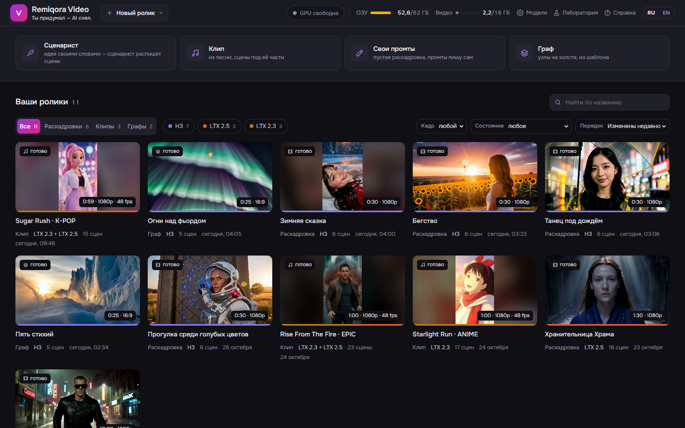

1. **Идея.** «Девушка в красном пальто идёт по ночной набережной под дождём, останавливается у фонаря и улыбается в камеру». Чем конкретнее место, свет, одежда и финал, тем связнее выйдут сцены. Ролик на 30 с — это 6 сцен по 5 с, на LTX — 3 сцены по 10 с.
2. **Раскадровка.** Сценарист справляется за 20–30 с. Сцены лежат монтажным листом, по строке на эпизод. Каждая правка сохраняется сразу. Сцену можно переписать, попросить другой вариант, закрепить удачные, добавить новую или перейти на свои промты. Во вкладке «Герои» Krea 2 рисует четыре пробы героя, и вы утверждаете одну портретом; во вкладке «Места» у каждого места одна картинка, и место от сцены к сцене остаётся тем же.
3. **Ролик.** Кнопка «Снять ролик». Черновик на 30 с снимается около 10 минут на H3 и 3,5–4 минуты на LTX. Можно остановиться после текущей сцены и продолжить потом: снятое остаётся в кэше. «Снять финал» переснимает те же сцены с теми же сидами в финальном размере.
4. **Монтаж** (по желанию). Обрезка, перестановка, переходы, трек, общий цвет, затем «Собрать ролик». Ничего не переснимается.
5. **Финал.** Как снято, 1080p, 4K, HDR10 или 48 кадров в секунду. Смена выхода только заново обрабатывает ролик и никогда не переснимает его.

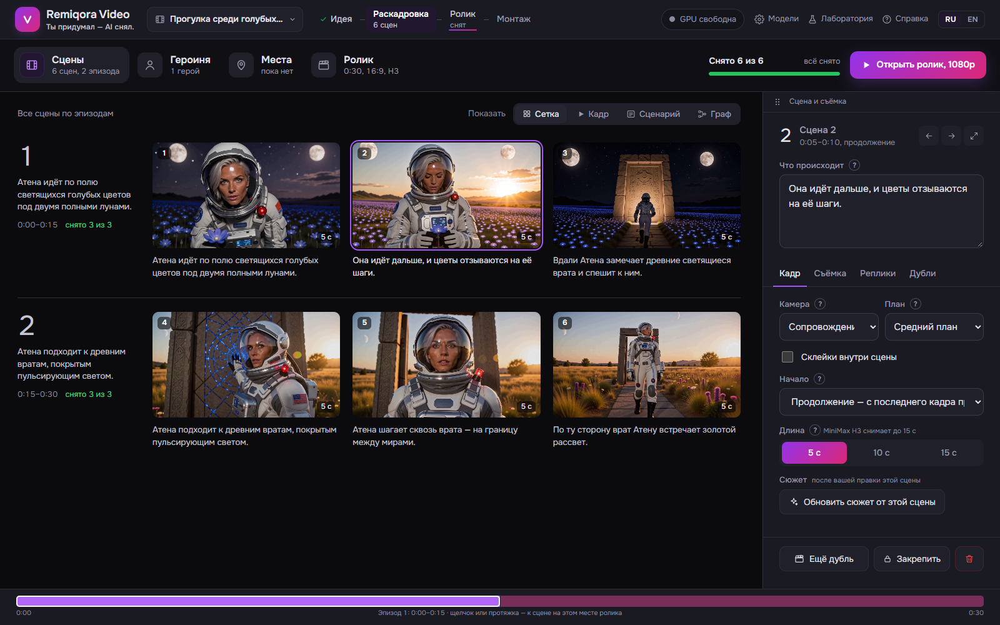

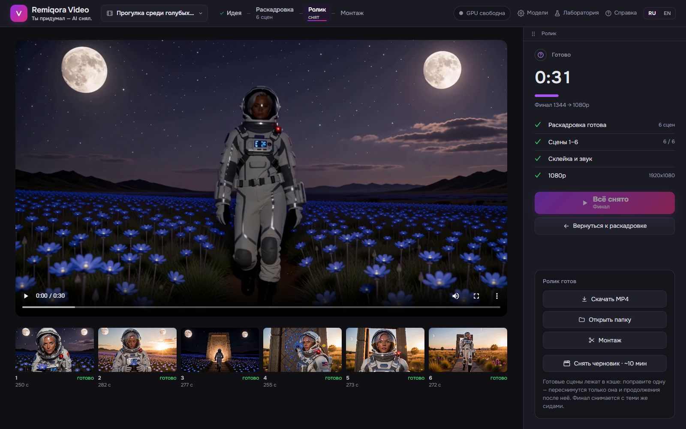

---

## Клип из песни

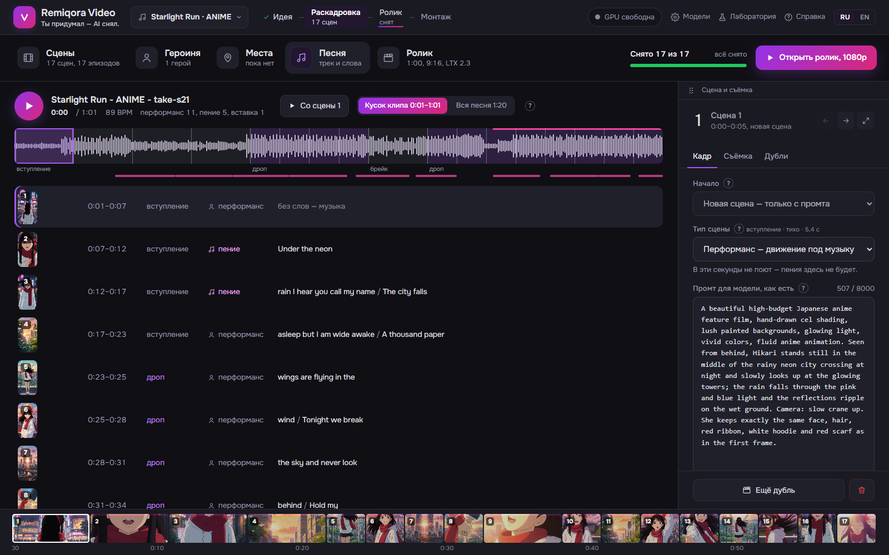

Переключатель «Клип» на главной. Песня разбирается примерно за секунду: темп, такты, тихие и громкие части, припев. Слова распознаются вместе с временем: голос отделяет Demucs, текст записывает Whisper large-v3, около 40 с на видеокарте. Сцены режутся по целым тактам: около 3 с в громких частях и вдвое дольше в тихих. Сцены бывают трёх видов: **пение** (лицо крупно, только там, где звучит голос), **перформанс** и **вставка** (деталь без лица). Сценарист сначала пишет тритмент — формат, палитру, мотив, который растёт к припеву, — потом сцены.

LTX 2.3 слышит свой кусок трека и двигает губами под голос, поэтому клипы по умолчанию снимает она. Если фото певца нет, Krea 2 рисует его по описанию сценариста, и поющие сцены начинаются с этого лица. FLUX.2 Klein рисует первый кадр каждой новой сцены с этим лицом, в месте сцены.

---

## Монтаж

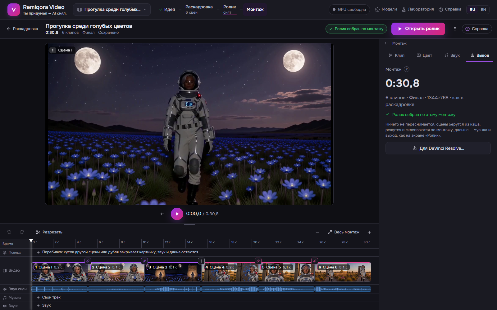

- Одна главная кнопка: «Собрать ролик», потом «Открыть ролик». Панель — во вкладках: Клип, Цвет, Звук, Выход.
- Края клипа тянутся мышью — это обрезка. **S** режет клип у плейхеда, **Ctrl+D** делает копию, скорость задаётся у каждого клипа (0,5–2×, высота звука не меняется).
- Цепочка двигается целиком, а значок над каждым стыком говорит, что это: без шва, скачок или новая сцена.
- Переходы: склейка, белая вспышка (4 кадра, по умолчанию при входе в громкую часть клипа), наплыв, через чёрное.
- Дубли: если у сцены их несколько, клип может взять любой, а раскадровка не меняется.
- **Поверх** — дорожка для перебивок: кусок другой сцены или дубля закрывает картинку на своём отрезке, а звук и длина остаются как были.
- Звук: свой звук сцены с громкостью у каждого клипа, ваш трек (громкость, начало, нарастание и затухание, «звук сцен под ним»), дорожка «Звуки» для ваших файлов. **Магнит** притягивает обрезку и звуки к долям трека, а «Склейки на доли» ставит каждую склейку на долю. Если доли найдены неточно, включите воспроизведение и жмите **B** на настоящих ударах: найденные доли сдвинутся и растянутся под них.
- Цвет: «Как снято», «Плёнка», «Тёплый», «Холодный», «Бирюза и оранж», «Чёрно-белый» или свой LUT `.cube`, с его силой, виньеткой и зерном плёнки; «До / после» показывает картинку с цветом и без. «Выровнять сцены по цвету» уравнивает цвет и контраст по всему ролику.
- **Ctrl+Z / Ctrl+Y** отменяют и повторяют любую правку. Плеер играет монтаж прямо в браузере, с переходами и звуком.
- **Для DaVinci Resolve:** таймлайн FCPXML с файлами, которые он играет, в выбранной вами папке. Ещё не снятые сцены становятся именованными пустыми местами своей длины.

---

## Граф

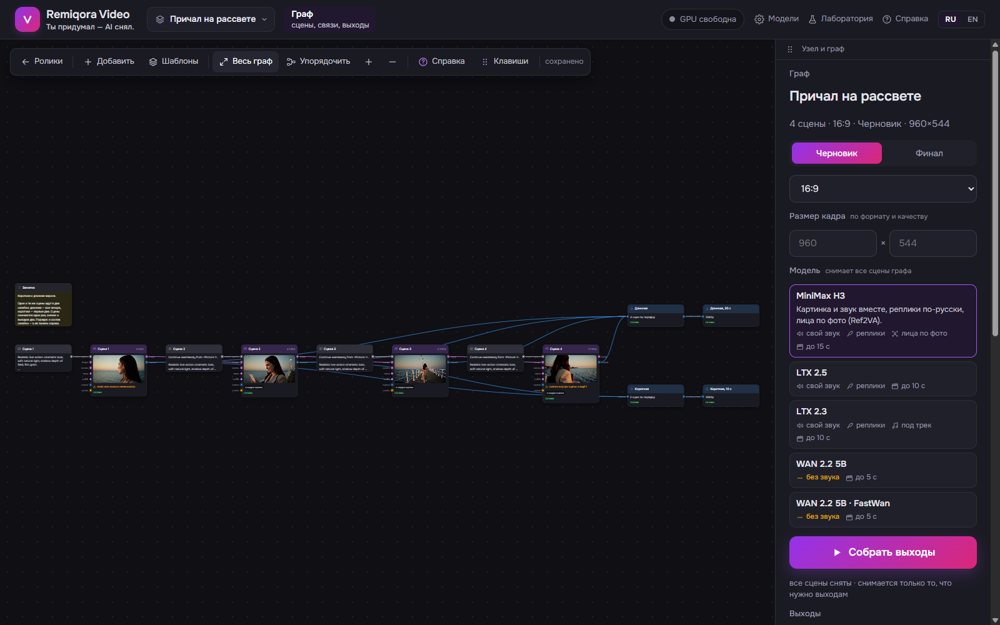

Раскадровка — это одна цепочка сцен. Граф — холст, где сцены, картинки, звук и выходы соединяются как угодно: два ролика из общих сцен, сцена, которая начинается с кадра посреди другой, голос из одной сцены у героя в другой, один стиль LoRA на всю цепочку. Каждый узел делает одно дело, связать можно порты одного типа, а снимается только то, что нужно выходам. У графа своя модель (H3, LTX или WAN), и у каждой сцены может быть своя.

**Из чего строится граф**

| Узел | Что делает |
|---|---|
| **Идея**, **Герой**, **Сценарист** | Идея и описание героев уходят Сценаристу: он пишет сцены, «Развернуть в сцены» строит из них промты, сцены, склейку и выход |
| **Промт** | Текст для модели — целиком или по полям, как в лаборатории; «Реплики» — кто что говорит |
| **Фото**, **Картинка** | Свой снимок или кадр, который рисует Krea 2 по промту или FLUX.2 Klein по картинкам-образцам (у каждой своя папка LoRA): первый кадр сцены или лицо для Ref2VA |
| **Сцена** | Снимает промт выбранной моделью; старт — с кадра, конец — к кадру (LTX), дубли с разными сидами |
| **Кадр**, **Звук сцены** | Кадр из любого момента снятой сцены; её звук — чтобы герой говорил тем же голосом в другой |
| **Лица** | Мелкие далёкие лица в снятой сцене — резче и одинаковые от кадра к кадру (LTX 2.3 и Krea 2) |
| **Видео → видео** | Переснимает клип через LoRA, которые читают сам клип: другой ракурс, 3D-рендер, без фона |
| **LoRA** | Один набор LoRA на несколько сцен; любую сцену можно отключить |
| **Склейка**, **Монтаж** | Сцены по порядку или таймлайн с обрезкой и переходами |
| **Трек**, **Музыка** | Ваш файл поверх ролика: громкость, начало, «звук сцен под ним» |
| **Выход** | Готовый ролик: размер, 1080p / 4K / HDR, 48 к/с; выходов может быть несколько |
| **Заметка**, **Группа** | Чтобы не запутаться в большом холсте |

**Шаблоны**

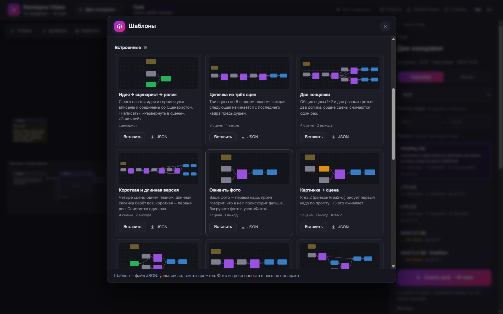

«Шаблоны» на холсте — 16 готовых графов; любой свой граф тоже сохраняется шаблоном и переносится файлом JSON.

| Шаблон | Для чего |
|---|---|
| Идея → сценарист → ролик | С чего начать: идея и героиня уже вписаны и соединены со Сценаристом |
| Сценарист · Сценарист и лицо по фото | То же без заготовки; второй — развёрнутые сцены снимает Ref2VA с фото героя |
| Цепочка из трёх сцен | Три сцены одним планом, каждая начинается с последнего кадра предыдущей |
| Две концовки | Общие сцены 1–2 и две разные третьи: два ролика, общие сцены снимаются один раз |
| Короткая и длинная версия | Четыре сцены; длинная склейка берёт все, короткая — первые две |
| Оживить фото | Ваше фото — первый кадр, промт говорит, что происходит дальше |
| Картинка → сцена | Krea 2 рисует первый кадр по промту, видеомодель его оживляет |
| Одно лицо в разных местах | Фото человека во вход «лица» двух сцен: Ref2VA держит лицо |
| Диалог двоих | Две сцены одним планом: она говорит, он отвечает |
| Другой ракурс с середины | «Кадр» с 2,5 с первой сцены — старт второй: тот же момент другим планом |
| Три дубля и лучший | Одна сцена с тремя сидами: снимите все, лучший пойдёт в склейку |
| Свой стиль через LoRA | Один набор LoRA во все сцены цепочки |
| Клип под свой трек | Три сцены со сменой плана, ваш трек вместо звука сцен, 1080p и 48 к/с |
| Трейлер: пять мест | Пять новых планов без людей, трек поверх, выход 4K |
| Пейзаж одной цепочкой | Три сцены без людей одной панорамой, 48 к/с |

**Три примера**

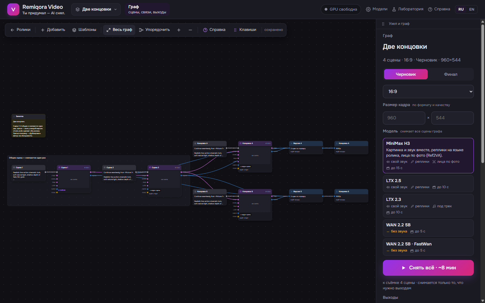

*Две концовки.* Сцены 1 и 2 общие, от второй отходят две разные третьи сцены, у каждой своя склейка и свой выход. Общие сцены снимаются один раз, а потом можно переписать любую концовку — переснимется только она.

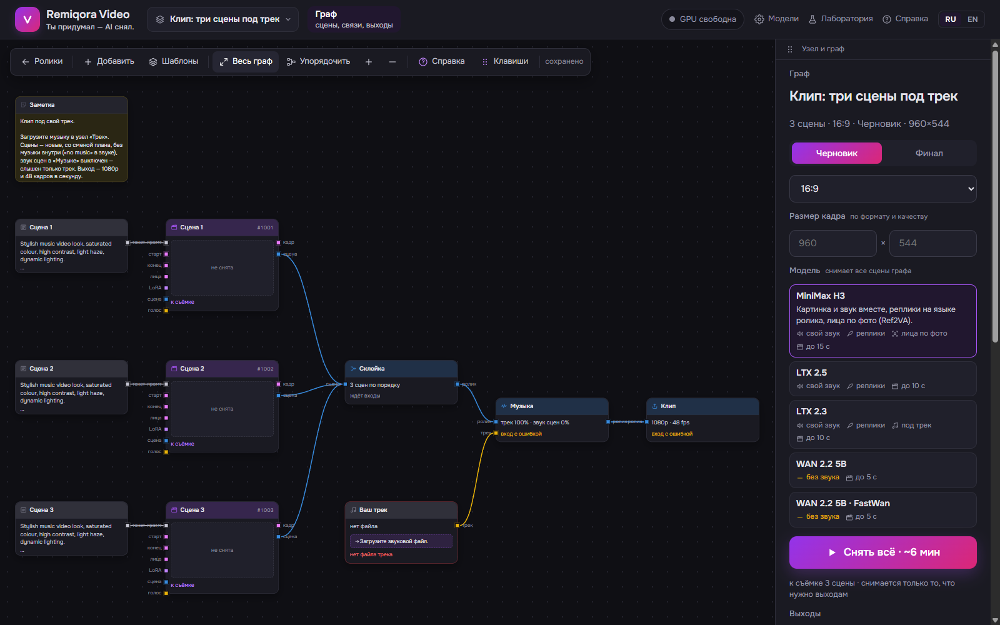

*Клип под свой трек.* Три сцены со своими промтами идут в склейку, «Трек» — ваш файл, «Музыка» кладёт его поверх и глушит звук сцен; «Выход» отдаёт 1080p и 48 к/с. Замените промты и трек — получится свой клип.

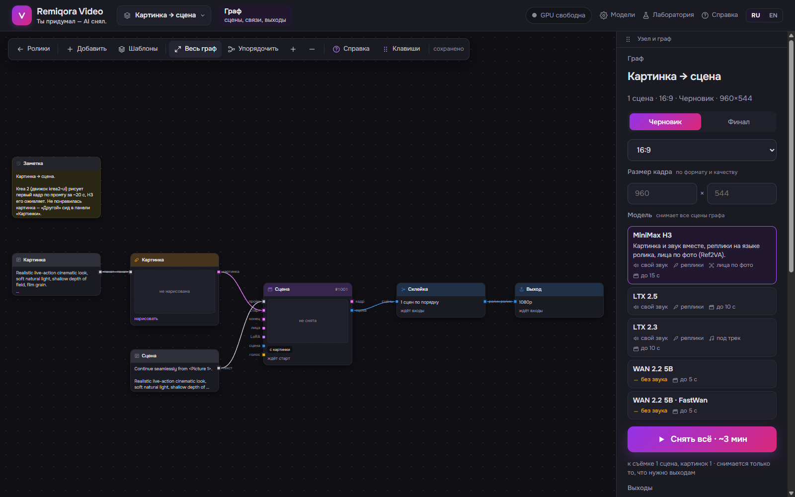

*Картинка → сцена.* «Картинка» рисует первый кадр по своему промту за несколько секунд — можно перебирать, пока не понравится; «Сцена» стартует с него и оживляет по второму промту. Так кадр и движение подбираются отдельно.

---

## Лаборатория

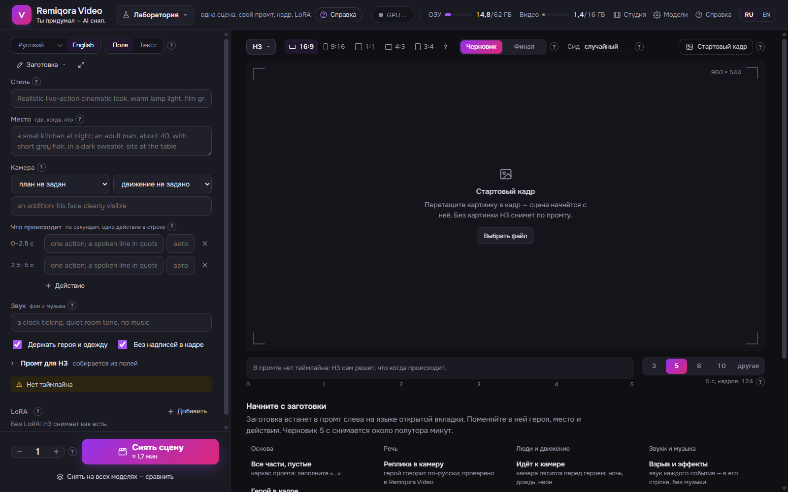

Одна сцена вручную, вне ролика: промт по полям (стиль, место, кто в кадре, действие, камера, звук, реплики) или одним текстом, стартовый кадр, LoRA и любая модель. Сценарист переводит описание на вашем языке в английский промт выбранной модели, а «Снять на всех моделях» сравнивает H3, LTX и WAN на одном промте и сиде. Пресеты закрывают частые случаи: оживить фото, реплика в камеру, диалог двоих, танец для клипа, природа, 3D-мультфильм, старая плёнка и другие.

## Страница «Модели»

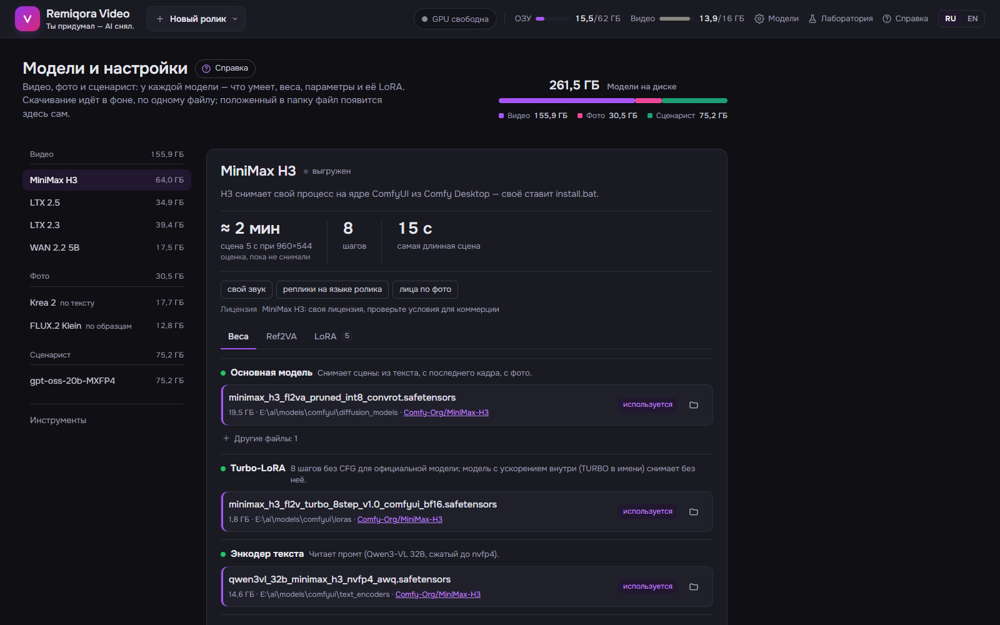

Файлы каждой модели по ролям: где лежит или куда скачается, размер и источник на Hugging Face. Скачивание идёт в фоне по одному файлу и продолжается после остановки; положенный в папку вручную файл появляется сам. Здесь же GGUF-модели сценариста, папки LoRA, пути к инструментам, измеренная скорость каждой модели на этой машине, а в десктопном приложении — кнопка «Добавить наборы моделей».

---

## На чём построено

Remiqora Video — это интерфейс, промты сценариста, раскадровка, конвейер съёмки и монтаж поверх чужих движков и моделей. Ни один из них не лежит в этом репозитории:

| Проект | Что используется | Лицензия |
|---|---|---|
| [ComfyUI](https://github.com/comfyanonymous/ComfyUI) (только ядро) | Движок всех видеомоделей, Krea 2 и FLUX.2 Klein. Наш воркер подключает его как библиотеку на закреплённом коммите (`engine/core.txt`), без сервера, страницы и кастомных узлов ComfyUI | GPL-3.0 |
| [MiniMax H3](https://huggingface.co/MiniMaxAI/MiniMax-H3) (перепаковка под ComfyUI: [Comfy-Org/MiniMax-H3](https://huggingface.co/Comfy-Org/MiniMax-H3)) | Видео со звуком, Ref2VA | MiniMax H3 Community License |
| [LTX 2.5](https://huggingface.co/Lightricks/LTX-2.5) / [LTX 2.3](https://huggingface.co/Lightricks/LTX-2.3) | Видео со звуком, клипы, ID-LoRA, IC-LoRA | LTX-2 Community License |
| [WAN 2.2 5B](https://huggingface.co/Comfy-Org/Wan_2.2_ComfyUI_Repackaged), [FastWan](https://huggingface.co/Kijai/WanVideo_comfy) | Видео без звука | Apache-2.0 |
| [Krea 2](https://huggingface.co/Comfy-Org/Krea-2) | Картинки | Krea 2 Community License |
| [FLUX.2 Klein 4B](https://huggingface.co/Comfy-Org/Flux-2-Klein-4B) | Картинки по образцу: первые кадры сцен, места | Apache-2.0 |
| [llama.cpp](https://github.com/ggml-org/llama.cpp) (или подписанный движок [LM Studio](https://lmstudio.ai)) | Локальный сервер сценариста | MIT |
| [Gemma 4 E4B](https://huggingface.co/ggml-org/gemma-4-E4B-it-GGUF) | Сценарист по умолчанию (подойдёт любой GGUF) | Apache-2.0 |
| [Demucs](https://github.com/adefossez/demucs), [faster-whisper](https://github.com/SYSTRAN/faster-whisper) | Голос и слова песни, голос сцены | MIT |
| [OpenCV](https://opencv.org) YuNet / SFace, [WeSpeaker](https://github.com/wenet-e2e/wespeaker) | Проверки клипа: лица, губы, похож ли голос | Apache-2.0 / CC-BY-4.0 (модель) |
| [RIFE](https://github.com/nihui/rife-ncnn-vulkan) (ncnn-vulkan) | 48 кадров в секунду | MIT |
| [NVIDIA RTX Video SDK](https://developer.nvidia.com/rtx-video-sdk) | 1080p / 4K (VSR) и HDR10 (TrueHDR) через нашу маленькую утилиту-трубу `rtx_vsr` | Проприетарная лицензия NVIDIA |
| [FFmpeg](https://ffmpeg.org) | Склейка, звук, кодирование | LGPL / GPL |
| [FastAPI](https://fastapi.tiangolo.com), [Vue 3](https://vuejs.org), [Vue Flow](https://vueflow.dev), [PyTorch](https://pytorch.org) | Сервер, страница, холст графа, среда движка | MIT / BSD |

---

## Лицензия и ответственность за созданное

Собственный код Remiqora Video (этот репозиторий) распространяется по [GPL-3.0](LICENSE) — как и ядро ComfyUI, на котором он работает. Эта лицензия относится только к приложению. На *видео*, которое вы с его помощью делаете, она не распространяется: видео создают чужие модели, поэтому:

- **Автор Remiqora Video не отвечает** за то, что вы создаёте и как используете это дальше — коммерчески или нет, публично или для себя.
- **За соблюдение местных законов отвечаете вы.** Некоторые модели, в том числе MiniMax H3, могут быть запрещены или ограничены в отдельных странах. Установщик и страница «Модели» скачивают веса прямо со страниц правообладателей на Hugging Face; Remiqora Video их не хранит и не распространяет. Перед установкой или использованием модели убедитесь, что это законно там, где вы живёте. Автор не несёт ответственности за установку и использование любой модели там, где она запрещена.
- **Реальные люди — только с их согласия.** Не создавайте и не публикуйте видео с реальным человеком (лицо по фото, голос по образцу) без его разрешения и не создавайте ничего незаконного.
- **Созданное видео подпадает под лицензию модели, которая его сделала.** Лицензии разные:
  - **MiniMax H3** — MiniMax H3 Community License. Прочитайте её условия до любого коммерческого использования.
  - **LTX 2.5 / 2.3** — LTX-2 Community License, бесплатно для компаний с годовой выручкой до $10 млн.
  - **WAN 2.2 5B** — Apache-2.0, коммерческое использование разрешено.
  - **Krea 2** — Krea 2 Community License.
  - **FLUX.2 Klein 4B** — Apache-2.0, коммерческое использование разрешено.
  - **Сценарист** пишет только текст; проверьте лицензию GGUF-модели, которой пользуетесь.
- Перед публикацией или монетизацией видео **проверьте актуальные условия на странице модели**: они принадлежат правообладателю модели и могут меняться независимо от этого репозитория.
- Файлы NVIDIA RTX Video SDK принадлежат NVIDIA и распространяются по её лицензии, а не по лицензии этого репозитория. В репозиторий они не попадают.
- Remiqora Video предоставляется «как есть», без каких-либо гарантий.
- **Авторство:** если вы делаете форк или строите что-то на этом коде, сохраните указание авторства — ссылку на этот репозиторий и на Николая Черкашина ([inikolax](https://github.com/inikolax)) как автора. GPL-3.0 к тому же требует сохранять уведомления об авторском праве и лицензии и публиковать исходный код своей версии, если вы её распространяете.

---

## 📦 Установка

Что нужно: **Windows 11**, **видеокарта NVIDIA RTX с 16 ГБ** видеопамяти (проверено на RTX 4080 16 ГБ, 62 ГБ ОЗУ, драйвер 617) и место под веса. Минимальный набор (H3 и сценарист) — около 53 ГБ, всё — около 210 ГБ ([Что скачать](#что-скачать)).

Установить можно двумя путями, как в Remiqora: установщиком `.exe` или скриптами из исходников. Оба качают **только официальные веса** авторов моделей (или официальные перепаковки Comfy-Org под ComfyUI) по одному списку — [`install/manifest.json`](install/manifest.json). Свои файлы — другие кванты, дообученные модели — кладите в папку моделей и выбирайте на странице **Модели**.

Наборы моделей:

| Набор | Что даёт | Размер |
|---|---|---|
| H3 | Главная видеомодель (официальная, с turbo-LoRA на 8 шагов) | 44 ГБ |
| Сценарист | Gemma 4 E4B и llama.cpp: промты, реплики, раскадровка | 9 ГБ |
| Krea 2 | Картинки: кастинг героев, места, «Картинка» по промту | 19 ГБ |
| FLUX.2 Klein | Первые кадры сцен по картинкам героя и места; «Картинка» по образцу | 14 ГБ |
| Ref2VA | Лица героев по фото (к H3) | 23 ГБ |
| LTX 2.5 | Вторая видеомодель; нужны токен Hugging Face и согласие с лицензией | 40 ГБ |
| LTX 2.3 | Клипы под готовый трек | 42 ГБ |
| WAN 2.2 5B | Быстрая модель без звука | 19 ГБ |

Профили: **Минимум** (H3 и сценарист, ~53 ГБ), **Картинки и лица** (+ Krea 2, FLUX.2 Klein и Ref2VA, ~109 ГБ), **Всё** (~210 ГБ). Установщик всегда добавляет движок (~6 ГБ), Whisper и Demucs для слов песни, модели проверок клипа, RIFE и RTX Video; скрипты ставят движок, остальное докачивается при первом использовании.

### Способ 1: установщик

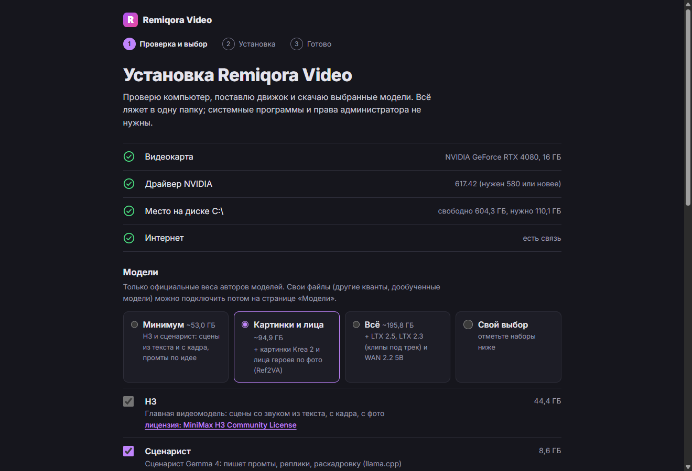

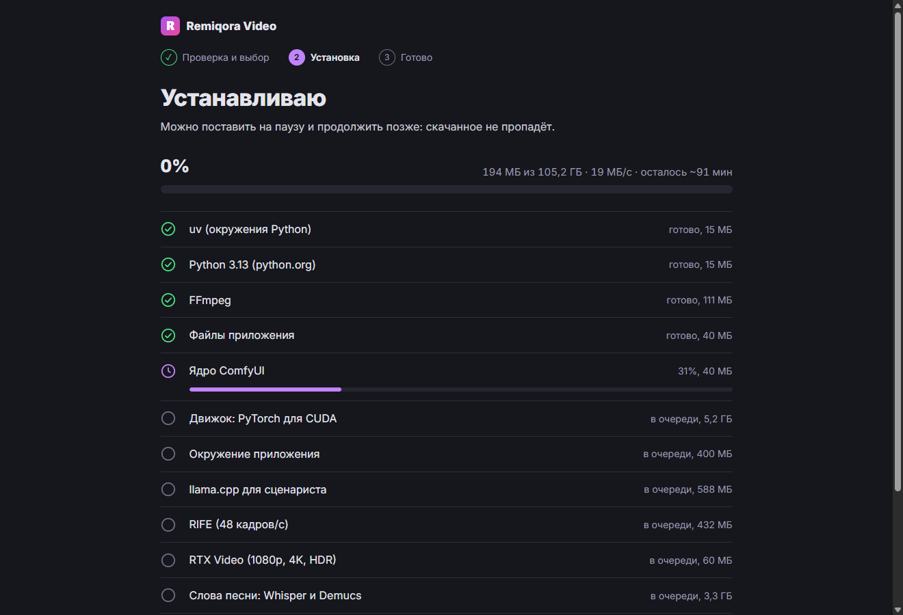

**Скачать:** [Remiqora-Video-Setup-0.2.1.exe](https://github.com/inikolax/remiqora-video/releases/download/v0.2.1/Remiqora-Video-Setup-0.2.1.exe) (v0.2.1, пре-релиз; суммы SHA-256 на странице [Releases](https://github.com/inikolax/remiqora-video/releases)).

`Remiqora-Video-Setup-<версия>.exe` ставится на пользователя, без прав администратора. При первом запуске мастер:

1. проверяет видеокарту, драйвер (нужен 580 или новее), место на диске и связь;
2. предлагает профиль или наборы по одному, ссылки на их лицензии и папки: приложения (по умолчанию `%LOCALAPPDATA%\RemiqoraVideo`) и моделей. Кнопка «Добавить папку» подключает уже скачанные веса ComfyUI, Comfy Desktop или Remiqora: совпавшие по имени и размеру файлы не качаются и остаются на месте;
3. сам скачивает uv, Python 3.13 с python.org (подписан), FFmpeg, ядро ComfyUI, окружения по lock-файлам, llama.cpp, RIFE и выбранные наборы — с паузой, докачкой и проверкой sha256. Недокачанный набор не останавливает остальные: «Ещё раз» продолжит с того же места;
4. открывает приложение в своём окне. Следующие запуски — сразу в приложение; недостающие наборы добавляются кнопкой «Добавить наборы моделей» на странице **Модели**.

Собрать установщик: `cd frontend && npm ci`, затем `cd desktop && npm ci && npm run dist` → `desktop\dist\Remiqora-Video-Setup-<версия>.exe`. RTX Video попадает внутрь, если перед сборкой выполнить `tools\rtxvsr\build.ps1 -SdkDir <папка NVIDIA RTX Video SDK>` (нужны VS 2022 Build Tools и CUDA Toolkit). Установщик не подписан: Windows покажет предупреждение SmartScreen.

### Способ 2: из исходников

```cmd
install.bat
```

На новой машине сначала запускается `setup_prereqs.bat`: он проверяет и при необходимости ставит Git, uv, Python 3.13, Node.js и FFmpeg через winget. После этого закройте окно, откройте новое и снова запустите `install.bat`. Драйвер NVIDIA ставьте сами с [nvidia.com/drivers](https://www.nvidia.com/drivers).

Дальше `setup_models.bat` спрашивает папку моделей (путь, `B` — окно выбора, Enter — по умолчанию). Можно указать папку ComfyUI или Comfy Desktop: веса останутся на месте, путь запишется в `.env`. Скрипт закрепляет ядро ComfyUI, создаёт окружения по lock-файлам, проверяет PyTorch/CUDA и в конце предлагает профиль моделей. Ключи:

- `-Profile minimum|faces|all` или `-Sets h3,writer,krea,flux2,ref2va,ltx25,ltx23,wan` — без вопроса;
- `-Find "D:\ComfyUI\models"` — ещё папки с готовыми весами;
- `-SkipWeights` — без моделей; `-DryRun -ModelsDir <папка>` — только проверить выбор папки.

Повторный запуск пропускает готовое и докачивает недокачанное. Для LTX 2.5 положите токен Hugging Face в `data\hf_token` (или задайте `HF_TOKEN`) и примите лицензию на странице модели. llama.cpp для сценариста скрипт не ставит: положите сборку в `tools\llama` или установите LM Studio.

### Запуск из исходников

```cmd
dev.bat
```

Собирает страницу (её же показывает [http://127.0.0.1:8810](http://127.0.0.1:8810)), запускает API на порту 8810 и страницу в режиме разработки Vite на [http://127.0.0.1:5173](http://127.0.0.1:5173). Правки интерфейса подхватываются в браузере сразу; после изменения Python-кода API перезапускается автоматически. При таком перезапуске активная съёмка прервётся. Воркер видеомоделей запускается сам при первой съёмке (журнал — `data\h3worker.log`). Чтобы остановить серверы разработки, закройте окна «Remiqora API» и «Remiqora UI».

### Модели после установки

Откройте **Модели** (шестерёнка в шапке). Там для каждой модели видно, какие файлы нужны, где они лежат или куда скачаются, и есть ссылка на Hugging Face. **Скачать** качает их в фоне по одному и продолжает остановленное скачивание. Файлы можно положить в папки и вручную — они появятся сами. Токен Hugging Face нужен только для закрытых репозиториев (для LTX 2.5 сначала примите лицензию на странице модели).

**Сценаристу** нужен `llama-server` и любая GGUF-модель. Сервер ищется в `LLAMA_SERVER_BIN`, затем в `tools\llama`, затем в установленной **LM Studio** (её подписанный движок CUDA). GGUF-файлы ищутся в папке загрузок LM Studio и в `LLM_DIRS`. Сценарист по умолчанию — Gemma 4 E4B.

**LoRA** приложение не качает: положите `.safetensors` в папку LoRA нужной модели (папки видны на странице «Модели»).

### Smart App Control

На чистой установке Windows 11 Smart App Control через несколько дней оценки может включиться сам. После этого он блокирует неподписанные файлы, которых не знает облако Microsoft. Сейчас многие сталкиваются с тем, что под блокировку попадают DLL torch, сборки llama.cpp и Python из uv или conda ([ComfyUI #15117](https://github.com/Comfy-Org/ComfyUI/issues/15117), [PyTorch #199711](https://github.com/pytorch/pytorch/issues/199711), [llama.cpp #30258](https://github.com/ggml-org/llama.cpp/issues/30258)). Remiqora Video берёт подписанные сборки там, где они есть (Python с python.org, движок LM Studio), и объясняет, что делать, если заблокирован сервер сценариста. Если что-то всё равно не пускает (в «Просмотре событий» — события Code Integrity 3033 / 3077, ошибка WinError 4551 или 0xC0E90002):

- подождите и попробуйте ещё раз: репутация у файла иногда появляется за час или день;
- или выключите Smart App Control: «Безопасность Windows» → «Управление приложениями и браузером» → «Smart App Control». С апрельского обновления 2026 года его можно включить обратно без переустановки Windows.

---

## ⚙ Настройки (.env)

Установщик записывает выбранную папку моделей в `.env`. Пути и папки можно изменить на странице **Модели**: они сохраняются в `data\settings.json` поверх `.env` и применяются без перезапуска. При ручной настройке задайте корень моделей:

```ini
H3_MODEL_ROOTS=D:\models\comfyui          # веса всех моделей; несколько папок — через ;
LORA_DIRS=D:\models\loras\h3
LTX23_LORA_DIRS=D:\models\loras\ltx23
LTX25_LORA_DIRS=D:\models\loras\ltx25
LLM_DIRS=D:\models\llm
RTX_VSR=D:\tools\rtxvsr\rtx_vsr.exe
RIFE_BIN=D:\tools\rife\rife-ncnn-vulkan.exe
```

- `H3_MODEL_ROOTS` — папки с `diffusion_models`, `text_encoders`, `vae`, `loras`, `checkpoints`, `latent_upscale_models`. В них ищутся веса всех моделей.
- `H3_UNET`, `LTX25_UNET`, `KREA_UNET` и подобные — имена файлов по ролям; их же выбирают на странице «Модели».
- `COMFY_DIR`, `COMFY_PYTHON` — движок. По умолчанию — свой `engine\` из `install.bat`; если его нет — движок Comfy Desktop.
- `LLAMA_SERVER_BIN`, `LLM_DIRS`, `LLM_MODEL`, `LLM_CTX` — сценарист.
- `FFMPEG`, `FFPROBE`, `RIFE_BIN`, `RTX_VSR` — инструменты. Для ffmpeg достаточно, чтобы он был в PATH.
- `HOST`, `PORT` — по умолчанию `127.0.0.1:8810`. Входа по паролю в приложении нет, поэтому не открывайте его за пределы доверенной сети.

Полный список с пояснениями — в [`.env.example`](.env.example) и в справке приложения («Настройки в .env»).

---

## Известные ограничения

- Только Windows и NVIDIA. Ориентир — 16 ГБ видеопамяти: LTX доходит до 15,7 ГБ, остальное держит в общей памяти Windows.
- Сценарист и видеомодель не помещаются в видеопамять вместе, поэтому работают по очереди. После сценариста видеомодель загружается заново — до полуминуты.
- В каждой сцене модель сочиняет свою музыку. Чтобы на весь ролик звучала одна мелодия, положите свой трек и включите «В сценах без музыки».
- Лица по фото (Ref2VA) держит только H3. LTX и WAN держат лицо описанием и стартовым кадром.
- Когда в кадре люди, цепочки делаются короткими: на длинных продолжениях лицо уплывает.
- Для 1080p / 4K через RTX Video и для HDR10 нужен `rtx_vsr` с файлами NVIDIA RTX Video SDK. В git их нет: установщик везёт их внутри, из исходников — `tools\rtxvsr\build.ps1`.
- Без NVIDIA RTX Video (другая видеокарта или сборка без её файлов) 1080p / 4K увеличивает ffmpeg (lanczos), а HDR10 недоступен.
- Установщик пока не подписан: Windows покажет предупреждение SmartScreen, а Smart App Control может заблокировать неподписанные файлы (см. выше).
